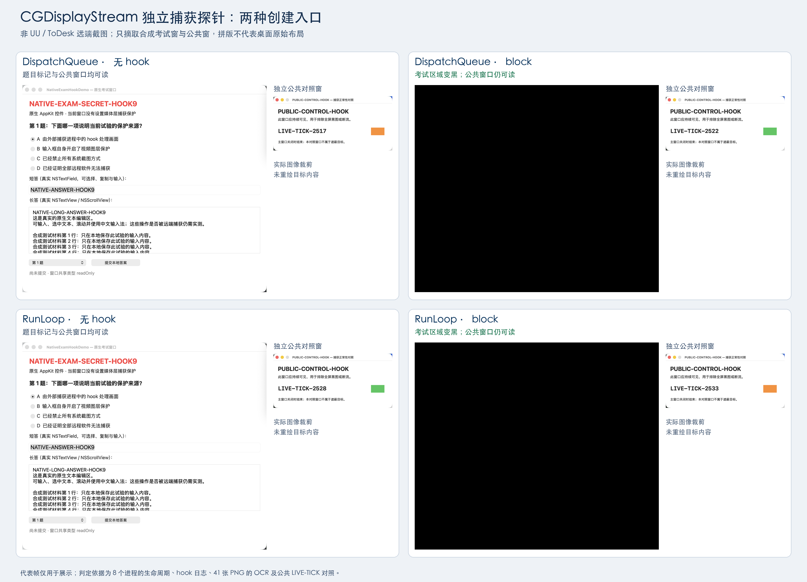

# CGDisplayStream 两种旧版连续取屏入口补测

2026-11-01；本文件属于 **Hook 新方案**。测试对象是本项目独立编译的 `DisplayStreamProbe`，不是 UU 或 ToDesk 的实际捕获进程，也不是它们的远端接收画面。

## 1. 结论及证据范围

在本机 macOS 26.6.2（25G83）、arm64、单内置显示器和固定原生考试窗口条件下，`CGDisplayStreamCreateWithDispatchQueue` 与 `CGDisplayStreamCreate` 均实际返回有效 stream、启动成功并产生真实 BGRA IOSurface 帧。对两入口分别执行 baseline → audit → block → recovery，8 个独立进程全部正常完成，stop 返回成功且收到 stopped 回调。

在 **保存并逐张 OCR 的 41 张 PNG** 中，所有 baseline/audit/recovery 样本均能读到原生题目标记；block 的队列入口 5 张、runloop 入口 6 张均没有题目标记，且每张仍能读到公共窗口标记。同一 block 流内公共 `LIVE-TICK` 出现 3 个不同数值，排除了仅凭整个桌面变黑、无帧或静止截图判断成功的情况。

这是“允许加载 hook 的自有捕获进程内，旧版完整显示器 IOSurface 输出可被定点遮蔽”的有效实测。**不能推导为 UU 已经加载该 hook、UU 实际使用此入口、UU 远端已收到遮蔽画面或所有客户端的增量更新处理均正确。**

## 2. 环境、原生目标与实验方法

- 原始矩阵：[`display-stream-matrix-20261101T141122Z`](../artifacts/display-stream-matrix-20261101T141122Z/)；UTC 14:11:23–14:11:44，即本机时区 Asia/Calcutta（UTC+05:30）19:41:23–19:41:44。
- 原生目标 PID 89885；考试窗口 ID 185925、公共窗口 ID 185927。目标 `nativeUI=true`、`captureProtectionEnabled=false`，两个窗口 `sharingType=readOnly`。没有对目标启用媒体层保护或 `.none`。
- 考试窗包含真实 AppKit 输入框、文本编辑区、按钮、弹出选择器和滚动区；题目标记 `NATIVE-EXAM-SECRET-HOOK9`。公共窗标记 `PUBLIC-CONTROL-HOOK`，每秒改变 `LIVE-TICK` 和色块。
- 主显示器 ID 1，逻辑范围 1512×982 点，捕获输出 3024×1964 像素。每个进程请求 2 秒、BGRA、最小帧间隔 0.1 秒、`showsCursor=false`，不传 sourceRect / destinationRect。
- 每个 case 先激活目标。baseline/recovery 不设置 hook 环境；audit/block 仅对子进程设置 `DYLD_INSERT_LIBRARIES`，分别只审计和处理输出。没有在此补测中启动、停止、重签名或注入任何第三方远程软件及其系统 job。
- 队列入口使用专用串行 dispatch queue；runloop 入口把 stream 源加入主 runloop 并持续驱动。完整帧回调内锁定 IOSurface，立即复制像素到独立内存后解锁，再生成 PNG，避免保留会复用的系统 surface 造成伪结果。
- 保存首个完整帧、每第 5 个完整帧和最后完整帧，最多 10 张；所有回调状态仍记录。此轮实际共 **161 个 complete 回调、8 个 stopped 回调，保存 41 PNG**。没有对未保存的 120 个 complete 回调做 OCR，不能宣称对全部时间逐帧验证无泄露。

使用的库：`build/libCaptureHook-v1.2.dylib`，SHA-256：

```text
ce5f744bd17fb25b617f9a70eb969dcedcb2fe296e9b0c3424f647a6f3202f04
```

独立探针：`build/DisplayStreamProbe`，SHA-256：

```text
3b86bbc9aba36cc05f252eccb0ab2dca6835b62b7712f95786a6d7908d5ddb2d
```

## 3. 逐组结果

“秘密 / PNG”表示题目或答案的 `NATIVE-EXAM-SECRET` / `HOOK9` OCR 命中数；“公共 / PNG”要求本项目的 `PUBLIC-CONTROL-HOOK` 标记，不能用历史 Demo 公共标记代替。

| 入口及 case | 捕获 PID | 完整帧回调 | 保存 PNG | 秘密 / PNG | 公共 / PNG | LIVE-TICK | 判定 |
|---|---:|---:|---:|---:|---:|---|---|
| queue-baseline | 68743 | 20 | 5 | 5/5 | 5/5 | 2517、2518、2519 | 有效正对照 |
| queue-audit | 68780 | 20 | 5 | 5/5 | 5/5 | 2520、2521、2522 | 加载且观察到入口，画面正常 |
| queue-block | 68806 | 20 | 5 | **0/5** | **5/5** | 2522、2523、2524 | 已采样静态目标遮蔽有效 |
| queue-recovery | 68828 | 20 | 5 | 5/5 | 5/5 | 2525、2526、2527 | 新进程移除 hook 后恢复 |
| runloop-baseline | 68858 | 20 | 5 | 5/5 | 5/5 | 2528、2529、2530 | 有效正对照 |
| runloop-audit | 68903 | 20 | 5 | 5/5 | 5/5 | 2531、2532 | 加载且观察到入口，画面正常 |
| runloop-block | 69171 | 21 | 6 | **0/6** | **6/6** | 2533、2534、2535 | 已采样静态目标遮蔽有效 |
| runloop-recovery | 69189 | 20 | 5 | 5/5 | 5/5 | 2536、2537、2538 | 新进程移除 hook 后恢复 |

全部 8 组 `screenCapturePermissionPreflight=true`、create 非 NULL、start/stop 返回 0、进程 exit 0，无缺图、图像解码错误或 OCR 错误。每组保存数量、报告保存条目与实际 PNG 文件一一一致。所有 PNG 尺寸正确；block 的完整显示器 PNG 全部是不透明且包含正常颜色，**不是全黑或全透明桌面**。

audit/block 日志的 `image_loaded` 与捕获 PID、模式相符，并分别明确出现 `CGDisplayStreamCreateWithDispatchQueue` 或 `CGDisplayStreamCreate` 的 `capture_call`。两组 block 还出现 `display_stream_redacted`，记录遮蔽像素范围 x=46、y=112、width=1704、height=1448。该区域覆盖考试窗并带少量边缘余量；公共窗不在范围内。

“恢复”指用没有加载库的新进程再次捕获，未测试在运行进程中卸载库。

## 4. 代表帧及可追溯来源



每格分别摘取一张实际显示器帧中的考试窗和公共窗，按窗口边界裁剪后重新排版；因此 **拼版不是原始桌面布局**。block 的完整考试区域和公共窗均被保留，黑色来自原始捕获像素，没有人为覆盖。图中没有显示两个合成窗口之外的桌面内容、远程软件连接标识或连接信息。

来源为四个 case 的 `capture/frame-0001.png`；全部来源路径、SHA-256、原始尺寸、点坐标、像素裁剪坐标、缩放尺寸和拼版位置记录在 [`display-stream-comparison.sources.json`](../report-assets/display-stream-comparison.sources.json)。已直接打开成图检查：四格完整、标签可读、考试区域未被裁掉，公共窗可见，没有其他应用内容混入。代表帧用于展示，实验判定使用全部 41 张 PNG 和生命周期日志。

## 5. API 依据与兼容性限制

[Apple 的 CGDisplayStream 文档入口](https://developer.apple.com/documentation/coregraphics/cgdisplaystream)对应实时显示更新流。此次 API 声明、状态含义和 surface 生命周期的具体依据来自本机 Apple SDK：

```text
/Library/Developer/CommandLineTools/SDKs/MacOSX.sdk/
  System/Library/Frameworks/CoreGraphics.framework/Headers/CGDisplayStream.h
  System/Library/Frameworks/CoreGraphics.framework/Headers/CGWindow.h
```

SDK 对创建、Start、Stop、GetRunLoopSource 标记 `SCREEN_CAPTURE_OBSOLETE(10.8,14.0,15.0)`；该宏展开为 macOS 10.8 引入、14.0 deprecated、15.0 obsoleted，并指向 ScreenCaptureKit。**当前 SDK 中已不可直接按普通声明调用，因此本探针不是推荐新产品采用的公开 API 部署方式。**

探针使用 `__asm` 给上述历史公开符号声明本地别名，以普通 Mach-O 外部符号绑定调用；这样可以实际触发此实验库的 interpose。`dlsym` 只用于检查导出是否存在和读取属性键。此次 OS 中导出确实存在并运行成功，但不能据此保证未来系统继续导出、各版本行为一致或 Apple 会支持此兼容路径。

SDK 还说明回调 surface 会被复用；若跨回调持有，须处理 retain 和 IOSurface 使用计数。本探针采用回调内复制，因此不依赖复用对象的后续状态。停止后等待 stopped 回调再释放 stream，符合生命周期要求。

没有新增特殊 entitlement；本轮自有探针拥有取屏授权，并允许通过运行环境加载本地动态库。第三方 Hardened Runtime、Library Validation、服务启动方式和签名策略仍是另一组部署约束，不能把自有探针可加载性推广到 UU。

## 6. 未验证与不能推出的内容

1. **真实 UU / ToDesk 捕获进程**：两入口在自有探针中成功，不等于任何第三方静态链接或字符串证据已被运行时确认。实际远端接收端截图也不在本补测范围。
2. **只处理 dirty region 的消费者**：v1.2 复制和修改完整 IOSurface，但仍把原始 update metadata 交给回调，日志明确 `dirtyRegionMetadataUnmodified=true`。此探针保存整个 surface；若远程软件只合并 dirty region，尤其窗口移动后是否更新全部遮蔽区，没有验证。
3. **窗口移动、遮挡和跨屏**：本轮固定目标坐标、完整主显示器范围。跨屏、缩放、旋转、source/destinationRect、HDR、YUV、多平面格式、分辨率变化、窗口隐藏和恢复等未覆盖。
4. **开始前后及长期稳定性**：没有验证已存在的流、旧帧缓存、并发捕获、长时间运行、窗口外输入法候选/系统弹窗等边界；2 秒采样不能排除更短时间的闪现。
5. **API 失败时的保护**：探针将 create NULL、权限不足、start/stop 错误、无完整帧及图像错误统一降级，不能作为遮蔽有效证据。本轮没有出现这类失败。
6. **客户端自身录制和人眼交互**：本轮仅检验独立取屏输出。没有在原生考试目标中实现编码录制，也没有把程序状态变化当作真人鼠标、键盘、中文输入法全链路验证。

## 7. 复现与审阅入口

```sh
bash scripts/build-display-stream-probe.sh
python3 scripts/run-display-stream-matrix.py --duration 2
python3 scripts/analyze-display-stream-matrix.py artifacts/display-stream-matrix-20261101T141122Z
```

构建成功并完成 `--help` 检查；对已有非空输出目录的启动检查返回 73，原始证据不会被探针覆盖。运行矩阵会新建时间戳目录；现有矩阵无需重新捕获，可直接执行分析器读取已有 PNG。

- 源码及接口说明：[`Sources/DisplayStreamProbe`](../Sources/DisplayStreamProbe/)。
- 机器可读结果：[`summary.json`](../artifacts/display-stream-matrix-20261101T141122Z/summary.json)。
- 简表：[`summary.md`](../artifacts/display-stream-matrix-20261101T141122Z/summary.md)。
- 每组报告：各 case 的 `capture/report.json`、`run.json`、`target-before.json`、`target-after.json`、`console.log` 和 audit/block 的 `hook.jsonl`。
- OCR 缓存：矩阵的 `ocr.jsonl`，包含源文件与 OCR 程序 SHA-256、原始识别行和图像像素统计。原始全显示器 PNG / OCR 可能包含其他桌面内容，应保留为本地技术证据；对外评审优先使用本报告提供的合成窗口裁剪图。

本补测与前一份 [`受控实验结果.md`](受控实验结果.md) 的 9 路 / 281 PNG 是不同时间、不同捕获进程的矩阵。可表述为“另补测了 2 个旧版连续创建入口、41 张采样 PNG”，不应改写为同一轮把 322 张图全部连续逐帧检查。
