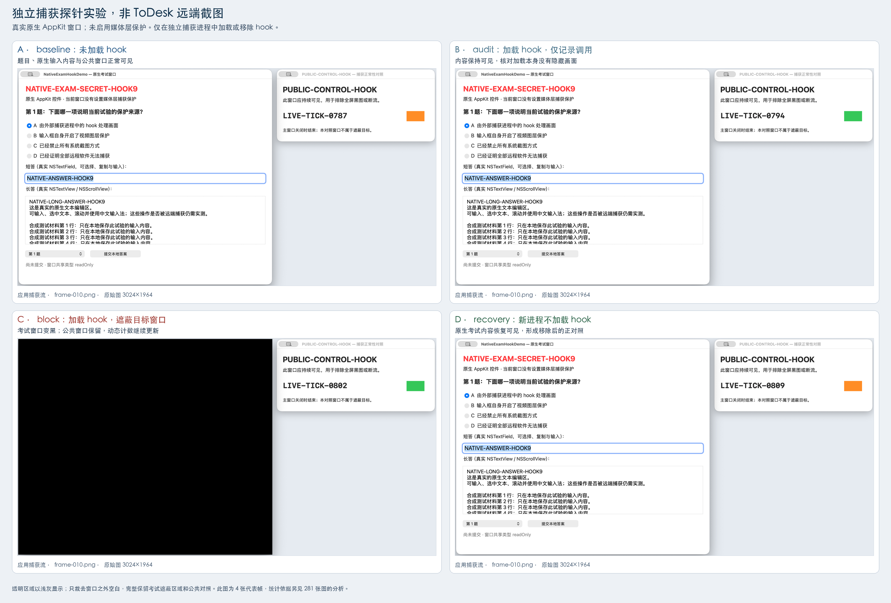

# Hook 新方案：原生窗口受控捕获实验

日期：2026-11-01。本文只报告独立捕获探针内的 hook 实验，**不是 ToDesk 或 UU 的远端接收画面验证**。

最终有效矩阵为 [`controlled-matrix-20261101T134227Z`](../artifacts/controlled-matrix-20261101T134227Z/)。在本机 macOS 26.6.2（25G83）上，v1.2 hook 对本轮 **9 条捕获路径**均形成了“无 hook 可读 → audit 可读 → block 秘密消失 → 移除 hook 后恢复可读”的对照链。共检查 **281 张 PNG：24 张单帧截图和 257 张连续流帧**。未把历史失败轮次合入这些有效样本。

本结论证明：在允许加载该库的自有捕获进程中，可以对普通原生考试窗口的捕获输出进行遮蔽。它不证明已能在任意第三方软件中安装 hook，也不证明所有捕获入口、系统版本、设备及时间边界均受到保护。

## 1. 目标、加载位置与对照设计

目标为 `NativeExamHookDemo`：真实 `NSWindow`、可编辑 `NSTextField`、`NSTextView`、`NSButton`、`NSPopUpButton` 和 `NSScrollView`。本轮目标 PID 为 89885，考试窗口 ID 为 185925，公共窗口 ID 为 185927。两窗共享类型均为 `readOnly`；`nativeUI=true`、`captureProtectionEnabled=false`。目标没有使用媒体层防捕获或 `sharingType=.none`。

秘密标记为 `NATIVE-EXAM-SECRET-HOOK9`，输入区还有 `NATIVE-ANSWER-HOOK9` 和 `NATIVE-LONG-ANSWER-HOOK9`。独立公共窗口显示 `PUBLIC-CONTROL-HOOK`，每秒更新 `LIVE-TICK` 和色块。公共窗口不属于遮蔽目标。

每组都启动新的独立 `CaptureProbe` 进程。本轮四个捕获 PID 均与目标不同：

| 顺序 | case | 捕获 PID | 库加载方式 | PNG 总数 | 其中连续流帧 | 进程结果 |
|---|---|---:|---|---:|---:|---|
| 1 | baseline | 15311 | 不设置 hook 环境变量 | 70 | 64 | exit 0 |
| 2 | audit | 15398 | 加载库，模式 audit；只记录 | 71 | 65 | exit 0 |
| 3 | block | 15475 | 加载库，模式 block；处理捕获输出 | 71 | 65 | exit 0 |
| 4 | recovery | 15818 | 新进程不加载库 | 69 | 63 | exit 0 |

本轮运行时间为 **2026-11-01 19:12:27–19:12:56（Asia/Calcutta，UTC+05:30）**。原始日志使用 UTC。每组约 7 秒，三个连续流各请求约 2 秒、目标约 10 fps；这些数字不表示扫描了物理显示器的每一次刷新。

使用的库为 `build/libCaptureHook-v1.2.dylib`，SHA-256：

```text
ce5f744bd17fb25b617f9a70eb969dcedcb2fe296e9b0c3424f647a6f3202f04
```

`audit` 和 `block` 的 `image_loaded` 及实际 API 调用日志均与对应捕获 PID、模式匹配。`baseline` 和 `recovery` 使用未加载库的新进程。`recovery` 验证的是新进程恢复，不是从一个存活进程卸载动态库。

## 2. 9 条路径的实际像素结果

下表单元格为 **秘密标记 OCR 命中数 / 实际 PNG 数**。四组的捕获权限均明确为已授权，目标窗口在本轮屏幕窗口列表中可枚举。所有实际 PNG 均完成解码及 OCR；没有缺图、保存计数不一致、流错误或 OCR 错误。

| 捕获路径 | baseline | audit | block | recovery |
|---|---:|---:|---:|---:|
| `CGWindowListCreateImage` 指定窗口 | 1/1 | 1/1 | **0/1** | 1/1 |
| `CGWindowListCreateImage` 桌面范围合成 | 1/1 | 1/1 | **0/1** | 1/1 |
| `CGDisplayCreateImage` 显示器 | 1/1 | 1/1 | **0/1** | 1/1 |
| `SCScreenshotManager.captureImage` 窗口 | 1/1 | 1/1 | **0/1** | 1/1 |
| `SCScreenshotManager.captureImage` 显示器 | 1/1 | 1/1 | **0/1** | 1/1 |
| `SCScreenshotManager.captureImage(in:)` 矩形 | 1/1 | 1/1 | **0/1** | 1/1 |
| `SCStream` 窗口 | 22/22 | 22/22 | **0/22** | 22/22 |
| `SCStream` 显示器 | 21/21 | 21/21 | **0/21** | 20/20 |
| `SCStream` 应用 | 21/21 | 22/22 | **0/22** | 21/21 |

“9 条路径”包含同一 API 的不同捕获范围，并不表示 9 个不同系统调用。应用级捕获只测试了连续流，没有测试应用级单张截图。

在 `block` 中，传统窗口截图、SCK 窗口截图、目标矩形截图，以及窗口流的 22 帧，均为**可解码的不透明黑图**。它们不是 API 报错、缺文件或全透明占位。显示器和应用输出保留了公共窗口：

| block 路径 | 公共标记命中 / PNG | `LIVE-TICK` 观察值 | 解读 |
|---|---:|---|---|
| 传统桌面范围合成截图 | 1/1 | 单帧，不用于证明连续运动 | 公共窗口仍可见 |
| 传统显示器截图 | 1/1 | 单帧，不用于证明连续运动 | 公共窗口仍可见 |
| SCK 显示器截图 | 1/1 | 单帧，不用于证明连续运动 | 公共窗口仍可见 |
| SCK 显示器流 | **21/21** | 0799、0800、0801 | 秘密消失时，公共画面仍继续变化 |
| SCK 应用流 | **22/22** | 0801、0802、0803 | 秘密消失时，公共画面仍继续变化 |

窗口和目标矩形路径本来不包含公共窗口，不要求它们出现公共标记。对应路径的正常捕获能力由前置 baseline/audit 与后置 recovery 验证。

## 3. 四组代表帧



图中四张均来自最终矩阵的 `sck-stream-application/frame-010.png`。应用过滤器只包含 `local.examcapture.hook.native`，`exceptingWindows=[]`；因此没有通过内容过滤器主动排除考试窗口。四张代表帧只用于直观展示，判定依据为全部 281 张输出图和日志。

图中只裁去了两个测试窗口之外的空白，完整保留考试遮蔽区域和公共对照。透明区域在成图时显示为浅灰背景；不透明黑色仍来自捕获原图。没有重绘、覆盖或修饰原始窗口内容，没有使用桌面截图，也没有展示远程软件连接标识或设备信息。

每张原图路径、SHA-256、原始尺寸、CG 窗口坐标、像素裁剪边界与缩放方法均记录在 [`controlled-comparison.sources.json`](../report-assets/controlled-comparison.sources.json)。成图已直接打开检查：四格文字和截图完整，无截断、重叠或缺字；block 中公共窗口可见，目标黑色区域完整保留。

## 4. 历史失败与降级轮次

以下资料全部保留，不能计入最终“9 路通过”的样本或作为第三方软件已完成拦截的证据。

| 目录时间戳 | 实际问题 | 处理 |
|---|---|---|
| `133231Z` | 旧库的 C 包装函数发生原函数解析递归；audit/block 捕获进程以 `SIGSEGV`（返回码 -11）退出。 | 两个失败 case 无有效拦截结论。baseline/recovery 的 123 张图保留，但没有有效 block 对照，不能算拦截成功。 |
| `133652Z` | `--only cg` 与应用捕获参数组合不兼容，四组均在参数检查阶段返回 64，0 张 PNG。 | 参数错误，未形成捕获实验；不能计作保护。 |
| `133946Z` | 目标不在屏幕窗口枚举列表中，窗口/应用路径被跳过，缺少正确的可见目标对照。 | 虽保留 101 张输出图，整轮按目标可见性不确定处理。切换空间或隐藏状态的具体根因未确认；明确重新激活后重做。 |
| `133510Z` | 旧库只验证连续流。显示器 baseline 被另一个 `NativeControlDemo` 窗口遮挡，题目标记截断，公共窗口计数也被挡住。 | 255 张图全部分析；窗口与应用流形成有效局部对照，显示器结果降级。不能把这轮当作完整三路径通过，也不与最终轮次重复计数。 |

每轮分析分别保存在对应目录的 `summary.json`、`summary.md` 和 `ocr.jsonl`。对 `133510Z` 显示器首帧做过直接视觉核查，确认存在遮挡；这类包含其他桌面内容的历史图没有纳入交付对照图。

## 5. 未覆盖的边界

- **第三方进程部署**：本轮 hook 安装在自有 `CaptureProbe`。ToDesk 和 UU 主程序、服务进程能否加载、实际由哪个组件取屏、远端是否真正收到遮蔽画面，应由另外的运行证据回答。
- **其他捕获入口**：本轮没有执行 `CGDisplayStream`、`captureSampleBuffer`、其他新增截图 API 或所有私有/内部路径。库里存在某个包装函数不等于该路径已经验证。后来使用独立新探针对两种 `CGDisplayStream` 创建入口另做了四组对照，见 [`CGDisplayStream补测.md`](CGDisplayStream补测.md)；后续 41 张采样图不计入本轮 281 张。
- **时间和几何变化**：本轮目标位置固定、单内置显示器、BGRA 输出。没有完成跨显示器、分辨率切换、窗口移动、最小化/恢复、已经存在的捕获流、进程重启、并发捕获、长时运行、帧间闪现与旧帧缓存的覆盖验证。
- **内容和交互**：只使用合成题目及原生控件预置文字。本轮 `--auto-type=false`，没有把程序更新值当成真人输入。中文输入法候选、右键菜单、弹出列表、系统弹窗、拖选、辅助功能读取等没有形成完整测试矩阵；窗口外的这些界面也不自动属于当前矩形遮蔽目标。
- **系统与部署**：仅此设备和系统构建。没有以关闭 SIP、修改系统文件或更改第三方应用签名为本轮前提。程序的授权条件和可加载性属于这一受控进程，不能推广到任意正式签名应用。
- **结果判据**：OCR 阴性并不证明所有可推断的信息都被消除；有限采样也不能排除短于采样间隔的泄露。全黑、全透明、API 返回成功或库加载成功，均不能单独作为保护结论。
- **自身录像**：本原生目标没有实现录像编码。未加载 hook 的捕获探针在 baseline/recovery 可以读取画面，但这不等于已完成考试客户端自身录制的产品实现。

## 6. 复核入口

```bash
python3 scripts/analyze-hook-matrix.py artifacts/controlled-matrix-20261101T134227Z
```

该命令只分析已有资料，不重新捕获，也不操作原生目标或第三方软件。OCR 缓存同时校验输入图片和检查器二进制 SHA-256，改动后自动重新检查。

- [最终统计与逐图观察 JSON](../artifacts/controlled-matrix-20261101T134227Z/summary.json)
- [最终自动统计表](../artifacts/controlled-matrix-20261101T134227Z/summary.md)
- [完整 OCR 缓存](../artifacts/controlled-matrix-20261101T134227Z/ocr.jsonl)
- [执行清单与库哈希](../artifacts/controlled-matrix-20261101T134227Z/manifest.json)
- [分析脚本及判据说明](../scripts/analyze-hook-matrix.README.md)
- [原生目标及状态协议](../Sources/NativeExamDemo/README.md)
