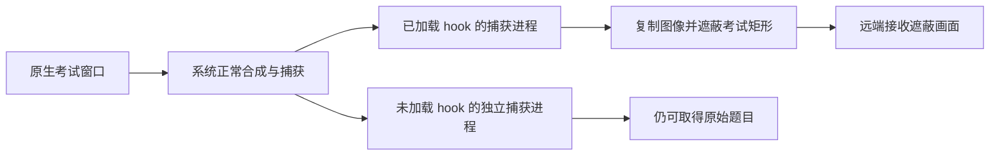
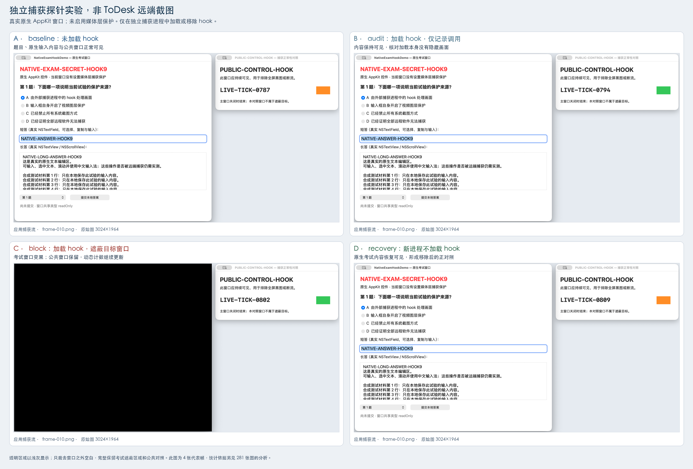
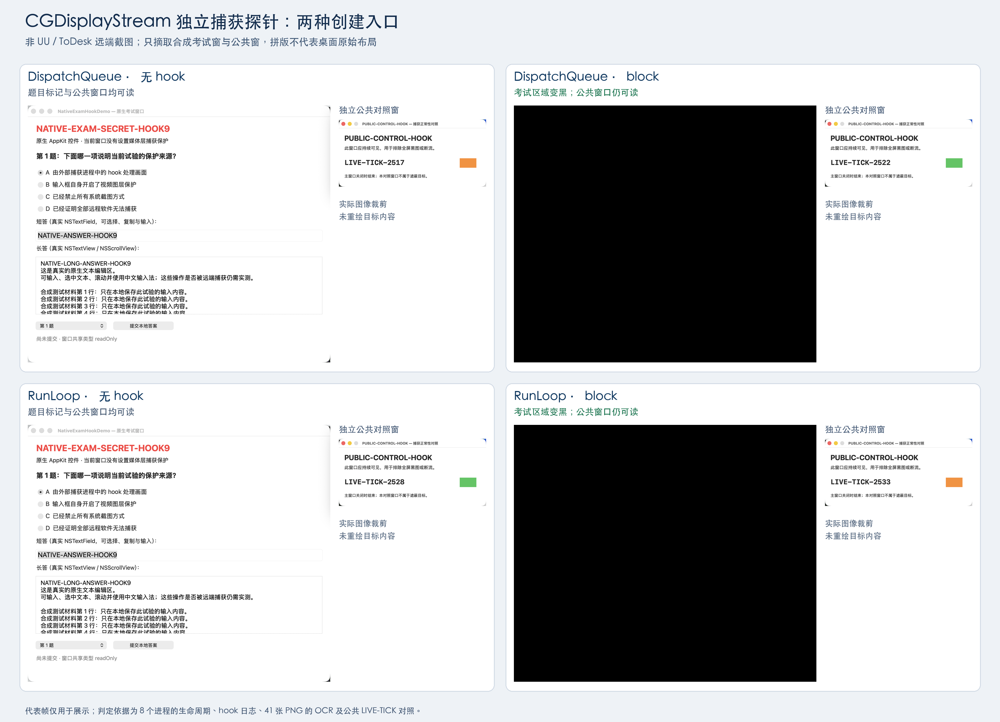

# macOS 原生考试窗口：捕获 Hook 新方案验证报告

日期：2026-11-01。独立项目：`Hook新方案_20261101`。本轮研究原生 UI 与捕获进程内拦截；此前受保护视频层方案的文档与代码未被覆盖。

## 1. 审阅结论

**在本机 ToDesk 的实际捕获进程中安装 hook，已让原生考试窗口在真实远端隐藏，同时保留公共窗口的持续变化；移除实验启动配置后考试内容恢复可见。** 这一结论具有真实调用日志、用户远端反馈及恢复对照。

**本轮没有实现 UU 遮蔽。** UU 原版主程序、用户服务和新派生的取屏子进程均没有加载最小实验库。这个负结果限定于本轮启动时加载方式，不能写成“所有 hook 方法都不可能”，也不能凭源代码里实现了 CGDisplayStream 就宣称已适配 UU。

**本方案没有实现“其他所有独立进程均无法获取考试内容”。** ToDesk 遮蔽期间，未加载 hook 的另一捕获进程仍截到了同一考试窗口，这是已保存的直接反例。当前方案适合进一步验证受控捕获软件或厂商协作集成，不满足通用考试防泄漏承诺。

| 目标或能力 | 本轮结论 | 证据等级 |
|---|---|---|
| 保留普通原生控件 | 已实现 NSWindow、输入框、文本区、按钮、滚动区与弹出按钮；没有把 UI 视频化 | 源码、目标状态、基线图；未覆盖所有控件人工交互 |
| ToDesk 远端隐藏考试范围，普通画面继续变化 | 本机 5.2.3.0 当前 SCK 路径通过 | 实际 Session 日志 + 用户远端三阶段观察 |
| UU 远端遮蔽 | 未实现；主程序及用户服务链加载尝试未见实验库 | 原版哈希、启动结果、成功 vmmap 查询、0 加载事件 |
| 自有捕获进程图像遮蔽 | 9 条捕获范围/模式与 2 种 CGDisplayStream 入口形成对照 | 281 张检查图 + 41 张 CGDisplayStream 采样图 |
| 系统级禁止所有外部取屏 | 不成立 | 未加载库的独立进程仍可截图的直接反例 |
| 自身正常录像 | 可保留未安装 hook 的自有捕获路径；新 Demo 未实现录像编码 | 架构推断与探针可读证据，不是已实现录像产品 |

## 2. 环境与版本

| 项目 | 实测环境 |
|---|---|
| 系统与硬件 | Apple M4，arm64，macOS 26.6.2（25G83） |
| SDK | macOS SDK 26.5 |
| ToDesk | 5.2.3.0，build 2943，原版应用 |
| UU | 4.40.0，build 621，原版应用 |
| 显示器 | 单内置显示器，1512×982 point，捕获 3024×1964 BGRA |
| 目标 | NativeExamHookDemo；本轮 PID 89885，考试 windowID 185925，公共 windowID 185927 |
| hook | v1.2，本地 ad-hoc 签名 |
| 系统保护 | SIP enabled；没有关闭 SIP、修改 TCC、修改第三方签名或重启 root 服务 |

已验证库 SHA-256：

```text
ce5f744bd17fb25b617f9a70eb969dcedcb2fe296e9b0c3424f647a6f3202f04
```

原生目标与主探针构建部署目标为 macOS 13，hook 为 macOS 14。这是编译设置，不是兼容性验收结果。历史 CG 符号可解析性、签名策略及系统行为须在每个目标版本单独测试；本报告只对上述一台机器作实测结论。

## 3. 实现机制

考试应用直接创建原生窗口和控件，不负责把窗口内容转成视频帧。遮蔽处理位于**捕获方进程**：系统生成正常捕获图像，hook 在回调结果处复制图像，将考试窗口对应区域填黑，再交给捕获方原接收对象继续编码和传输。

**原始像素已经进入捕获方进程地址空间。** 因此，即便本轮远端传输结果被遮蔽，也不能把不受信任的捕获进程视为从未取得原始考试像素。进程内处理不是抵御宿主主动绕过或读取原始缓冲区的隔离边界。



目标应用输出 windowID、ownerPID 和屏幕坐标范围。ownerPID 当前只用于审计，未参与 windowID 重用校验；配置更新与帧采集不同步，固定窗口实验不能保证移动时没有瞬间泄露。

| 层次 | 本轮实现 |
|---|---|
| CoreGraphics C 入口 | dyld `__interpose` 包装 CGWindowListCreateImage、CGDisplayCreateImage、CGDisplayStreamCreate 及 WithDispatchQueue |
| ScreenCaptureKit | Objective-C runtime 替换部分截图方法、SCStream 初始化/输出注册/生命周期方法，并跟踪公开过滤器范围 |
| 单帧 | 复制 CGImage，映射考试矩形并填黑 |
| SCK 连续流 | 输出代理接收 BGRA CVPixelBuffer，复制遮蔽，重建 CMSampleBuffer，保留时间戳及可传播附件后转交原对象 |
| CGDisplayStream | 包装真实 handler，复制完整 BGRA IOSurface 后遮蔽回调；不修改系统共享原 surface |
| 日志 | 记录进程、调用、尺寸、状态和抽样帧处理结果；不记录远程凭据或输入文本 |

这是进程内 API 包装与回调处理，不是 WindowServer 级窗口策略，也不是只检测到远程软件名称后停止其画面。DYLD 环境用于新进程启动，本项目没有向任意存活进程附加注入的能力。

### ToDesk 与 UU 的加载差异

ToDesk 主要宿主启用 Hardened Runtime，同时声明允许 DYLD 环境变量与关闭 Library Validation 的例外；实际在 Proxy 与 Session 中获得库加载及取屏调用日志。UU 对应原版组件没有声明这些例外，最小库测试未见日志和映射。官方规则与实测相符，但没有取得 dyld 逐阶段拒绝原因，不能把某一个缺失 entitlement 写成已单独定位的唯一原因。

权限属于宿主签名，给考试客户端加 entitlement 不会改变其他应用。屏幕录制授权也不等于允许第三方宿主加载任意动态库。官方依据见[部署与边界](部署与边界.md)。

## 4. 证据标准

分开检查目标可见、独立捕获有效、库实际加载、实际接口命中、输出像素变化、远端观察。API 返回成功、全黑图片、进程退出和远端断流均不单独算成功。

自有探针使用四组独立进程：baseline 不加载库；audit 加载记录但不遮蔽；block 处理图像；recovery 以不加载库的新进程恢复。要求秘密标记消失，公共窗口仍可读且 LIVE-TICK 变化。只含目标窗口的捕获不要求公共窗出现，依靠前后基线证明入口正常。

ToDesk 远端证据是用户反馈，未收到接收端截图或录像。报告图片均为本地独立探针输出，不冒充远端证据。OCR 阴性不证明所有信息不可推断；有限样本不能排除观察间隙泄露。

## 5. 捕获实验矩阵与截图

| 路径/范围 | baseline | audit | block | recovery |
|---|---|---|---|---|
| CGWindowListCreateImage 指定窗口 | 可读 | 可读 | 目标黑图 | 可读 |
| CGWindowListCreateImage 桌面合成 | 可读 | 可读 | 目标隐藏、公共可读 | 可读 |
| CGDisplayCreateImage | 可读 | 可读 | 目标隐藏、公共可读 | 可读 |
| SCK captureImage 窗口 | 可读 | 可读 | 目标黑图 | 可读 |
| SCK captureImage 显示器 | 可读 | 可读 | 目标隐藏、公共可读 | 可读 |
| SCK captureImage 矩形 | 可读 | 可读 | 目标黑图 | 可读 |
| SCStream 窗口 | 可读 | 可读 | 22/22 帧秘密未命中 | 可读 |
| SCStream 显示器 | 可读 | 可读 | 21/21 帧秘密未命中、公共可读且计数变化 | 可读 |
| SCStream 应用 | 可读 | 可读 | 22/22 帧秘密未命中、公共可读且计数变化 | 可读 |
| CGDisplayStreamCreateWithDispatchQueue | 可读 | 可读 | 5/5 采样图秘密未命中、公共可读且计数变化 | 可读 |
| CGDisplayStreamCreate | 可读 | 可读 | 6/6 采样图秘密未命中、公共可读且计数变化 | 可读 |

前九行保存并解码/OCR **281 张 PNG**：24 张单帧截图、257 张连续流输出。后两行的八组共收到 **161 次完整帧回调**，采样保存并 OCR **41 张 PNG**，未声称检查全部 161 次回调像素。共 322 张检查图来自不同采样规则，不能写成“逐帧零泄露”。11 行含不同范围及同一接口的两种入口，不等于 11 个不同系统调用。



图 1：主矩阵应用级流代表图，仅含合成考试窗与公共窗；黑色来自实际捕获输出。图示不替代完整矩阵。来源和裁剪说明见 [sources JSON](../report-assets/controlled-comparison.sources.json)。



图 2：自有 CGDisplayStream 探针输出，不是 UU 远端截图。抽样方式与限制见 [CGDisplayStream 补测](CGDisplayStream补测.md)。

## 6. ToDesk 真实远端闭环

实际捕获进程为 ToDesk_Session，实际命中 SCStream 显示器流。用户级 Proxy 派生 Session；root Service 没有被替换或注入。

| 阶段 | 进程证据 | 用户原始反馈 |
|---|---|---|
| audit | Session PID 19317；实际 SCStream 回调保留图像 | 两个窗口内容都能看到，LIVE-TICK 在变化 |
| block | Session PID 32469；实际图像回调发生遮蔽 | 考试区域已隐藏，右侧计数仍在变化 |
| restore | 恢复原 /Library 启动任务，Session 正常重启 | 考试内容已恢复可见，右侧计数正常变化 |

日志仅在首次及每 60 次回调记录，不等于所有帧。block 有 130 条带 BGRA 图像的抽样遮蔽记录，另有 35 条无 imageBuffer 回调，后者不计遮蔽成功。日志与用户观察相互支持，仍不能代替长期逐帧检查。


图 3：ToDesk block 期间未加载 hook 的独立探针输出，1700×1444，OCR 秘密标记命中。这个直接反例说明原生窗口的系统可捕获性没有消失。详情见 [ToDesk 实机验证](ToDesk实机验证.md)。

## 7. UU 的加载负结果

额外实现只依赖 libSystem 的 libLoadWitness.dylib，不取屏、不改帧，仅在加载时记录进程。自有宿主阳性对照通过，用于减少捕获框架依赖和 hook 代码带来的混淆。

| 对象 | 启动方式与 PID | 观察 |
|---|---|---|
| UU 主程序 | 原版可执行文件 + 进程级 DYLD 环境；56546 | 存活，0 加载日志；vmmap 成功，0 映射；文件哈希不变 |
| UU Service | 临时用户任务定义副本；72311 | 从副本运行，0 加载日志；vmmap 成功，0 映射 |
| 新派生 Server | Service 72311 的新子进程 72316 | 0 加载日志；vmmap 成功，0 映射 |

“仅向用户服务链添加启动环境即可覆盖 UU”没有得到支持。Service 启动成功不等于库加载，静态导入不等于当前正在调用。root Daemon 和特权 Helper 不在注入范围，没有重签 UU 或关闭系统保护。

活动取屏栈、人工连线状态和最终恢复见 [UU 加载验证](UU加载验证.md)，未收到的反馈不计通过。

## 8. 历史失败与工程边界

历史失败全部保留：旧版 C 原函数解析递归导致 SIGSEGV；参数冲突导致 exit 64；其他窗口遮挡导致无效基线；目标未在屏幕枚举中导致缺失路径；首次 ToDesk block 启动竞争使 bootstrap 返回 5 并自动恢复。均不计为遮蔽成功。v1.2 修正 C 入口原函数绑定后重跑有效矩阵。

当前实现是 **fail-open**：配置无效、格式/范围/裁剪不支持、分配或锁定失败时原样放行。SCK 与 CGDisplayStream 保留原 dirty-region 元数据，没有强制将新遮罩加入更新范围；只消费脏区域或缓存旧画面的接收端，在窗口移动/策略切换时可能出现本轮未覆盖的旧像素问题。

| 缺口 | 本轮边界 | 后续验收 |
|---|---|---|
| 捕获方不加载库、更换后端 | 已有可读反例；UU 未加载 | 厂商合作或可管理捕获端，每个进程/入口重验 |
| 非 BGRA、裁剪、HDR、多屏 | 未完整覆盖，部分原样放行 | 支持集合、坐标转换、不支持时的明确拒绝策略 |
| 移动/缩放/最小化、缓存 | 配置与帧没有原子同步 | 旧/新位置、dirty rect、缓存刷新和逐帧测试 |
| 菜单、输入法候选、系统弹窗 | 单矩形不自动包含其他窗口 | 追踪全部敏感窗口，实测输入流程 |
| 辅助功能、剪贴板等 | 不属于帧处理能力 | 单独定义保护需求 |
| 稳定性和性能 | 未测 CPU、延迟、长时增长 | 多小时、重连、丢帧、CPU/GPU/内存测试 |
| 自身录像 | 未编码录像 | 自有录像模块与外部遮蔽并行验收 |

3024×1964 BGRA 约 23.76 MB/帧（十进制，不含行对齐），复制每帧会增加读写与分配。这只是尺寸计算，不是吞吐或性能实测；计数继续变化不能证明生产延迟达标。

## 9. 部署判断

| 路线 | 分级 | 依据 |
|---|---|---|
| 自有捕获程序或可集成软件 | 可直接实现有限范围 PoC | 11 行受控对照成立，仍受格式和生命周期限制 |
| 本机当前 ToDesk 用户 Session | 本机 PoC 已实现；产品化需约束与回归 | 原版签名条件及真实远端对照 |
| 本机原版 UU 相同启动方式 | 本轮未实现 | GUI/Service/Server 均未加载见证库 |
| UU 厂商集成/捕获过滤点 | 需要厂商支持与验证 | 可研究捕获后、编码前过滤；尚未实施 |
| 任意存活第三方进程通用 hook | 当前方案不可直接实现 | 无通用加载授权及覆盖保证，未实现附加注入 |
| 承诺所有外部捕获不可读 | 不可行，已有反例 | 未加载库的独立进程仍可读 |

公开捕获类型和运行时机制的使用，不等于 Apple 或远程软件厂商支持任意第三方宿主部署。此 hook 未提供官方系统级窗口捕获策略扩展点；系统强制保证仍需 Apple/厂商支持，不能由用户态包装推导。

## 10. 复现、恢复与证据入口

按 [README](../README.md) 执行原生 Demo → ToDesk audit → block → restore，每次切换重连并观察计数。切换会重启用户代理/会话，不是在线卸载库。脚本校验精确 label、路径和原 plist 哈希，失败自动恢复，异常需先查看保存状态。

实验只创建任务定义副本并临时加载，不改写原 /Library plist。ToDesk 原 plist 与四个关键可执行文件哈希一致。UU 原文件及任务恢复也单独记录。最终机器状态见 `research/final-restoration-check.json`；进程存在本身不证明远程连接可用。

- [主矩阵统计](../artifacts/controlled-matrix-20261101T134227Z/summary.json)、[完整分析](受控实验结果.md)。
- [CGDisplayStream 实验](CGDisplayStream补测.md)。
- [ToDesk 真实验证](ToDesk实机验证.md)、[用户恢复反馈](../artifacts/todesk-block-20261101T135207Z/human-recovery-observation.json)。
- [UU GUI 结果](../artifacts/uu-load-witness-20261101T140503Z/result.json)、[UU 服务加载结果](../artifacts/uu-service-witness-20261101T141332Z/load-check.json)。
- [源码边界](../Sources/CaptureHook/README.md)、[静态审计](远程软件静态分析.md)、[官方依据](部署与边界.md)。

图片均为真实输出或有来源记录的裁剪排版，没有生成模拟远端结果。旧交付文件完整保留。
