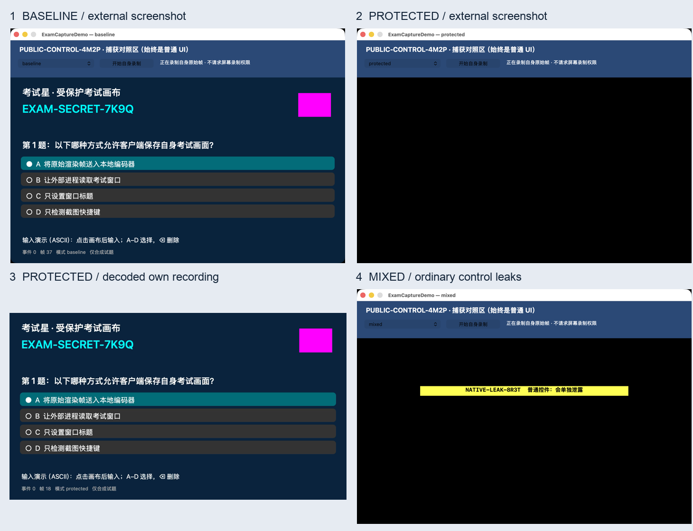

# macOS 考试窗口防截屏预研与 Demo

**2026-11-03 设计：[远控伪装识别与考试管控详细方案](docs/远控伪装识别与考试管控详细方案_20261103.md)。** 首版采用管理员授权后的身份检测、考前清理、考中发现后终止与复查、上报及结束恢复，不依赖 ES 专用授权；ES 执行前拒绝作为后续可选增强。文档包含改名/重签边界和分模式验收；这是待实施方案，不能当作已有能力。

**2026-11-03 新增：[远控软件运行检测测试](docs/远控软件运行检测测试_20261103.md)。** 独立只读检测已在本机连续三轮确认 ToDesk、UU、向日葵均有运行组件，不依赖 Hook 注入；提供签名核验、未知项及同名负例测试。尚未接入考试门禁、强退或服务端上报。

**2026-11-02 当前总审计：[Hook 路线完整审计与架构决策](docs/Hook路线完整审计与架构决策_20261102.md)。** 项目现包含受保护画布、原生控件栅格化、第三方进程 Hook 等不同原型，结果不能互相替代。Hook 路线仅 ToDesk 指定版本取得有限远端遮蔽验证；UU、向日葵的原版加载尝试未验证成功。未加载 Hook 的独立采集进程仍能取得题目，因此该路线不能承担通用防作弊的主要保障。总审计还记录了本轮复现的代码缺陷、考试生命周期缺口及替代路线的实际边界。

以下为 **2026-11-01 原始受保护画布 PoC** 的介绍，不代表普通原生 Hook Demo 已具备相同的画面保护和自身录像功能。后续[原生控件验证](原生控件验证_20261101/docs/原生控件验证报告.md)已发现中文输入法候选等保护范围之外的泄露。

**本机已经实现并验证可行原型：受保护考试画布正常显示，已测外部捕获未获得试题，自身从原始渲染帧录制的 MP4 保留试题。** 这需要把敏感 UI 渲染到受保护视频 Layer；不能据此承诺任意现有窗口、所有系统版本、所有录屏软件都能被一键屏蔽。

本次设备：Apple M4、macOS 26.6.2（25G83）、内置 Retina 屏幕；SDK 26.5。调研及测试日期：2026-11-01。用户已确认 protected 模式在本机屏幕可见完整题目，并反馈点击和输入正常；原始确认记录在 `artifacts/interactive-validation/human-verification.json`。

## 直接使用

双击 **[启动Demo.command](启动Demo.command)**，或打开 **[ExamCaptureDemo.app](build/ExamCaptureDemo.app)**。默认是 protected 模式，顶部可切换五组对照，点击“开始自身录制”，关闭窗口完成 MP4。

- **[技术预研报告](docs/技术预研报告.md)**：结论、路线对比、可行性分级、官方依据。
- **[本机测试结果](docs/本机测试结果.md)**：真实结果、失败项、连续帧分析、性能及证据位置。
- **[PoC 设计与复现](docs/PoC设计与复现.md)**：构建、运行、录制、输入与产品化限制。
- **[实验矩阵与验收](docs/实验矩阵与验收.md)**：已覆盖与必须补测的路径。
- **[公开 API 依据](docs/API依据.md)**、**[DRM 与系统路线](docs/DRM与系统路线.md)**：版本、权限、entitlement、部署与官方原始资料。



图中的“自身录像”是实际 MP4 解码帧，不是系统截图；图中的外部截图来自独立 CaptureProbe 进程。物理显示是否正常由用户现场确认，不能由这张图替代证明。

## 最重要的选择

1. **公开 API 原型：** `AVSampleBufferDisplayLayer.preventsCapture`（macOS 10.15+）+ 自有帧分流录制。本次已运行，普通原生控件不自动受保护，完整考试产品需要渲染架构改造。
2. **考试专用官方路线：** `AutomaticAssessmentConfiguration`（macOS 10.15.4+）官方支持考试会话禁止截图/录屏，但需 Apple entitlement；本机未获授权、未运行。自己的原始帧录像与它的兼容性仍需验证。
3. **不能作为保证：** `.sharingType = .none` 在本机出现遮蔽，但 Apple 现行文档已明确不推荐用于排除捕获，且部分入口直接失败，不能把这些算保护通过。
4. **没有找到公开的通用扩展点：** System Extension、ES、DriverKit 不提供按窗口并按捕获进程授权的全局策略接口。无需也未安装 Kext、关闭 SIP 或修改系统安全设置。

源码、脚本、原始截图、逐帧 PNG、JSON 日志、MP4、官方资料快照均保存在本目录。截图可能含测试时的桌面背景，原始证据只保存在本机。PoC 使用合成题目，并故意保存明文参考帧/录像供核验，不能直接作为正式保密客户端分发。

## Git 仓库与本地资料

仓库默认分支为 `master`，保存源码、脚本、调研文档、交付报告及未归档对话导出。各级 `build/`、`artifacts/`、`sandbox-apps/` 和缓存由 `.gitignore` 排除；文档中指向这些目录的历史证据、录像和第三方应用实验副本需要在原工作目录查看，克隆仓库不会包含它们。

ClearKey 媒体实验使用独立的 [Bento4 上游仓库](https://github.com/axiomatic-systems/Bento4)，固定版本为 `b8c50a078356a1c3444ce0a8744634ed488424a4`。本地第三方源码副本未重复提交；需要重做该实验时，可恢复对应版本并构建工具：

```bash
git clone https://github.com/axiomatic-systems/Bento4.git 深度调研_20261101/research/clearkey/Bento4
git -C 深度调研_20261101/research/clearkey/Bento4 checkout b8c50a078356a1c3444ce0a8744634ed488424a4
make -C 深度调研_20261101/research/clearkey/Bento4/Build/Targets/any-gnu-gcc
```
