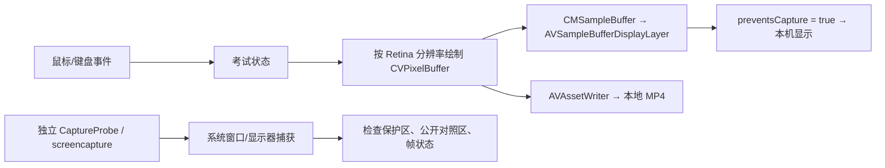

# PoC 设计与复现

## 本 PoC 的准确边界

这是原生 AppKit 合成试题 Demo，不是现有考试星客户端的完整改造，也没有处理真实考生数据。它用 CoreGraphics 将题干、选项、输入回显绘制到一个 IOSurface-backed BGRA CVPixelBuffer，再生成 CMSampleBuffer。默认整个敏感画布只通过 `AVSampleBufferDisplayLayer.preventsCapture = true` 显示。

独立 CaptureProbe 进程执行截屏/录屏 API。考试进程自身直接将原始像素帧送入 AVAssetWriter 输出 H.264 MP4，不通过屏幕截图绕过保护。因此“自身录制”表示录制客户端自绘考试画布，不是获得一个能捕获任意受保护窗口的进程白名单。它不包括其他应用、系统弹窗、标题栏、原生工具栏，也不包含声音或系统鼠标指针。要录制完整考试体验，所有题目相关弹窗、菜单、光标、选区及输入法呈现都必须进入统一渲染模型。



## 文件

- `Sources/ExamCaptureDemo/main.swift`：考试 Demo、输入事件、视频显示、原始帧录制。
- `Sources/CaptureProbe/`：独立捕获工具及 legacy CG API shim。
- `scripts/inspect-media.swift`：实际解码 MP4、读取 PNG、Vision OCR；不依赖 Demo 声称的成功状态。
- `scripts/run-matrix.py`：五种模式、每种启动独立进程、截图与流捕获、媒体检查。
- `artifacts/latest-matrix.txt`：最新自动矩阵目录的绝对路径。
- `research/`：官方文档快照和 SDK 依据。

## 构建与使用

在项目根目录运行：

```bash
./scripts/build-demo.sh
./scripts/build-probe.sh
xcrun swiftc -swift-version 5 -O scripts/inspect-media.swift -o build/InspectMedia -framework AppKit -framework AVFoundation -framework Vision
open build/ExamCaptureDemo.app
```

无需完整 Xcode，Command Line Tools 和支持相应 API 的 macOS SDK 即可。本次构建固定 `arm64`、最低运行 macOS 13；这是 Demo 构建选择，**不表示 preventsCapture 最低版本是 13**。Intel 需要修改 target 为 `x86_64` 或构建 universal；未在 Intel 实测。SCK 单张截图 API 需 macOS 14，旧版本探针跳过该项；流捕获仍可用。

Demo 模式：

| 模式 | preventsCapture | sharingType | 原生叠加控件 | 用途 |
|---|---|---|---|---|
| baseline | false | readOnly | 无 | 捕获权限和渲染正对照 |
| window-none | false | none | 无 | 只验证旧窗口属性 |
| protected | true | readOnly | 无 | 核心公开 API 路线 |
| both | true | none | 无 | 组合验证 |
| mixed | true | readOnly | 黄色 NATIVE-LEAK 控件 | 验证保护不覆盖普通 UI |

点选答案，或按 A–D；点击画布后输入 ASCII 可看到回显，退格删除。当前只演示鼠标命中和基本键盘事件，不支持中文输入法组合文本、文本选择、复制粘贴、富文本编辑及 VoiceOver 完整导航。顶部控制栏刻意保持普通 UI，用于检查截图是否真的捕获到了目标窗口。

点击“开始自身录制”，关闭窗口或 Cmd+Q 时完成 MP4。默认交互输出为项目 `artifacts/interactive`。强制杀进程可能使 MP4 未完成，不应这样结束录制。CLI 可指定时长和目录：

```bash
./build/ExamCaptureDemo.app/Contents/MacOS/ExamCaptureDemo --mode protected --record --duration 20 --output artifacts/manual-protected
./build/CaptureProbe --permission --output artifacts/permission
./build/CaptureProbe --target-name ExamCaptureDemo --output artifacts/manual-capture
python3 scripts/run-matrix.py
```

探针及命令行截屏需要屏幕录制授权；Demo 的原始帧录制不使用屏幕录制接口。命令行程序的 TCC 归属可能是启动它的终端/宿主，不能将本机已授权推断为新分发 app 自动获得权限。只有缺权限时才手动使用探针 `--request-permission` 并在系统设置授权、重启相关进程；不编辑 TCC 数据库。

## 验证规则

1. 同一机型、OS、显示器、分辨率、权限下先跑 baseline。公开标记 `PUBLIC-CONTROL-4M2P` 和题目标记 `EXAM-SECRET-7K9Q` 都应能抓到。
2. protected 必须确认窗口存在、已呈现、外部探针有权限、公开标记仍可见，再判断题目区域是否被遮蔽。`isReadyForDisplay` 和 renderer status 只是辅助诊断，不能证明人眼实际看到了试题。
3. 在真实屏幕上确认受保护题目和输入反馈正常；保存人工记录。远程桌面画面/系统截图不能代替这一观察。
4. 不只看一张截图：检查 SCScreenshotManager、SCStream 的窗口/显示器两条路径，检查多帧和系统 screencapture。OCR 不识别也不能单独证明没有泄露，结合原图和标记色块检查。
5. 解码自身 MP4，确认实际能播放且有题目、答案状态，而不是只检查 `AVAssetWriter.status`。
6. mixed 中原生控件可能泄露；这正是必须改造 UI 渲染架构的证据。保护 Layer 不会自动保护兄弟/子控件、其他窗口或可访问性文本。
7. CG 历史 API 返回 null、路径不存在、权限拒绝、窗口消失、SCStream 无 complete 帧，一律记为失败/无效样本，不记作保护通过。

## 性能与产品化

本 PoC 默认 900×500 pt、Retina 2×、1800×1000 px、20 fps、BGRA、H.264 8 Mbps。单原始帧约 7.2 MB，20 fps 最低像素写入量约 144 MB/s；缓冲池、编码器和显示队列会增加驻留内存与总带宽。日志 `renderMeanMS/renderP95MS` 包含绘制、缓冲入队、编码 append 调用等 CPU 提交工作，**不等于呈现延迟、编码延迟或端到端延迟**。不能把 M4 上的短测试外推到 Intel/4K/双屏/长考试。

- 文字：按 backingScaleFactor 生成原生像素，避免低分辨率放大。生产环境要处理窗口大小变化、跨显示器 scale 变化、色彩空间、HDR、字体栅格化与细字体编码损失。本 Demo 固定窗口大小。
- 刷新：题目静态时可按需更新，光标/滚动/视频需同步节拍。生产中将渲染和编码移出主线程，限定队列深度，明确丢帧策略，处理 flush/失败与切屏恢复。本 Demo 便于观察，主线程定时绘制。
- Web 内容：WKWebView 的 snapshot/离屏绘制不能天然保证整个 Web 页面、DOM 控件、视频、弹出窗口、输入法都进入受保护管线；需专项原型。不要先在可见普通窗口显示敏感内容再抓取成视频，会有首帧泄露。
- 输入：保持逻辑 UI 树、命中测试、键盘焦点和编辑模型；完整实现 NSTextInputClient 或受控离屏文本编辑，并审查输入法候选框/系统辅助 UI 是否泄露。
- 无障碍：像素画布丢失原生语义。提供辅助元素/VoiceOver 会向获授权的辅助进程暴露文本，这与“任何其他进程不能得到内容”的强目标冲突，需要明确威胁模型和考试无障碍方案。本 PoC 只提供不含题目文本的通用标签，不宣称符合无障碍要求。
- 自身录制：生产录像应覆盖题目/作答/焦点/必要光标，且保护原始帧、临时文件和录像。当前 `source-reference.png`、MP4 是为调试刻意保存的明文证据；它们本身是内容副本，不能照搬进正式保密客户端。
- 部署：当前 ad-hoc 本地签名，无 sandbox、无特殊 entitlement。面向其他设备分发要 Developer ID、Hardened Runtime、公证和相应权限测试；这些措施不会把显示防护升级成绝对安全边界。
