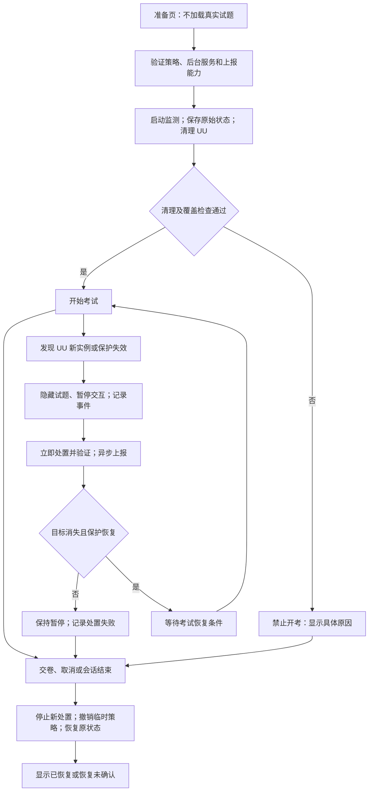

# UU 考试进程管控设计

日期：2026-11-02。范围：当前 macOS NativeExamDemo，先针对已经验证的 UU 版本和组件建立策略。

2026-11-03 修订：首版明确采用管理员服务的 `reactiveTerminate`，完整交付检测、门禁、发现后终止、复查、上报和恢复，无需 ES 专用授权。ES 执行前拒绝作为可选增强。三家软件共用架构和新的全量身份发现要求见[详细方案](远控伪装识别与考试管控详细方案_20261103.md)；下述 11 月 2 日只读事实保留原测试日期，不代表新增处置代码已完成。

**本文完成的是可实施设计，尚未新增终止进程、后台服务、ES 或网络上报代码。** 本轮只读核对了工程和两个 UU 启动任务；没有停止 UU、改变启动配置或安装服务。

## 1. 用户要求与能力定义

1. 考前检查 UU；发现正在运行时强制退出，通过清理验证后允许进入考试。
2. 考中发现 UU 进程重新出现，记录并向考试服务器上报。
3. 对重新出现的 UU 执行处置，确认结果；无法处置时暂停考试。
4. 结束或中断后撤销本次临时限制，恢复确实改变的原始状态。

| 模式 | 实际执行方式 | 可以承诺的行为 | 不可承诺的行为 |
| --- | --- | --- | --- |
| 第一版：`reactiveTerminate` | 已批准的后台服务发现目标进程后终止；考前临时卸载已确认的 UU 启动任务以减少自动拉起 | 在已支持的范围内发现、记录、尝试终止并核验退出 | 零运行窗口、所有瞬时进程都能发现、程序执行前拒绝 |
| 增强版：`execDeny` | 获 Apple 授权的 Endpoint Security 对命中的 `AUTH_EXEC` 作拒绝决定；保留存量进程清理 | 对实际收到且正确处理的授权事件，在目标程序映像执行前拒绝 | 自动关闭已有会话、所有远控方法都被覆盖、组件失效时仍持续阻断 |

“终止启动”在第一版界面中应写成“发现运行后已终止”；增强版只有取得执行拒绝结果时才显示“执行请求已拒绝”。普通启动通知和更快轮询也属于第一种。

首版没有 ES entitlement 时显示 ES“不适用”，按管理员服务、监测健康、目标身份及上报等本模式条件准入。只有策略明确要求 `execDeny` 时，缺少 ES 授权或部署条件才阻止该增强模式；不能静默降级。终止已运行进程本身不以 ES 获批为前提。

## 2. 现有工程与本机事实

- [main.swift](../Hook新方案_20261101/Sources/NativeExamDemo/main.swift) 在 `applicationDidFinishLaunching` 中先构建并显示试题窗口，再调用安全检查；当前没有考前门禁。`applicationWillTerminate` 仅保存状态并停止定时器。
- [UUHookMonitor.swift](../Hook新方案_20261101/Sources/NativeExamDemo/UUHookMonitor.swift) 提供只读进程、模块和历史观察，没有终止 UU 的功能。主程序每 5 秒触发，整轮扫描预算 9 秒；不能将它用作快速处置通道。
- 当前签名字段是磁盘元数据，候选发现仍依赖可执行文件名。进入强退设计前必须补身份验证，不能把同名程序直接当 UU。
- 本轮只读确认：`/Library/LaunchAgents/com.netease.uuremote.agent.plist` 与 `/Library/LaunchDaemons/com.netease.uuremote.daemon.plist` 均设置 `RunAtLoad=true`、`KeepAlive=true`。因此仅发送终止信号可能触发系统自动拉起，不能把所有再次出现都写成考生主动操作。
- 当前没有可复用的正式上报服务契约，也没有本 Demo 已安装并可用的特权服务证明。既有只读监测测试不等于本设计的处置测试已通过。

## 3. 考试状态机



策略覆盖、目标运行情况、事件上传情况分别保存，不能合并成一个“安全”布尔值。`active` 必须同时满足本模式所要求的条件；不能因检查器暂时没有返回结果就继续开考。

## 4. 考前清理流程

1. **只展示准备页。** 不创建包含真实题目/答案的控件，也不提前下载本轮不需要的试题。准备页显示考试期间将关闭 UU 的规则。
2. **建立考试会话。** 接收服务器签发的会话和策略，固定策略版本、模式、目标组件和有效期。确认必要的管理员后台服务已批准、可连接且版本正确；注册成功不等于服务已就绪。
3. **先启动持续监测，再做初始扫描。** 防止只有一次扫描而没有后续接管；这仍不将轮询变成原子封锁。
4. **验证目标并保存原状态。** 保存本次涉及的进程身份、对应 launchd 域/任务、是否已注册/启用/运行，以及可信原始定义的摘要。恢复日志由后台服务保护，并在第一次改变状态前写入成功。
5. **停止自动拉起和存量进程。** 针对已验证且原本加载的两个已知任务，临时从对应运行域卸载；不改厂商 app、磁盘 plist、签名或 TCC。再对残留的已确认组件发送终止请求，短暂宽限后必要时强制结束。每步均有时限和结果验证。
6. **重新核验。** 确认必管组件已消失、任务状态符合策略、观察通道可用。可配置连续两次干净扫描和短暂稳定观察，但仅将其作为当时检查通过，不声称整段时间绝无进程。
7. **允许开考。** 提交准备结果并满足服务端准入规则后显示试题。权限不足、未知相关候选、持续自动拉起、恢复日志写入失败时停止开考流程，并撤销已经完成的临时改变。

清理对象包括已支持版本中的 GUI、Service、Server、Daemon。Updater/Helper 只在角色和身份已经验证并纳入策略时处理。系统 Daemon 涉及整机用户，应将支持范围先限定到已确认的考试用户会话；多用户/未知共享状态不自动扩大处置。

临时卸载任务用于解决已知 KeepAlive 来源，不是对手无法再次启动或重新注册任务的保证。重新出现仍由考中监测处理。第一版不采用无限循环杀进程、不写持久禁用项。

## 5. 考中检测、处置与上报

### 快速监测独立于 Hook 审计

新增轻量进程监测，不调用 `vmmap`，不等待 UI 主线程的 5 秒定时器。可用 GUI 启动通知提供提示，加独立队列的全角色补偿扫描；GUI 通知不覆盖所有后台启动。

建议初始扫描间隔为 250–500 毫秒，具体值以 CPU 开销和实测延迟校准。优先核验新发现或身份变化的对象，并周期复查已有身份与未知项；缓存绑定文件/执行身份和策略版本，变化或到期即重验。不能仅凭主文件 stat 不变复用整个包的完整性结论；同 PID 重新 exec 的非 ES 身份限制按新详细方案明确披露。扫描中发生过载、积压或身份读取失败，应暴露覆盖不足。间隔不是最大响应时间保证，短于扫描间隔的进程仍可能漏掉。

现有 Hook 模块检查继续作为低频诊断；发现 UU 不需要先等 Hook 检查完成。无法加载我们的库，也不是终止 UU 的前置条件。

### 每次发现后的有界事务

1. 为新的进程生命周期创建事件 ID，记录 `uu_process_observed`。考前已有实例记为清理对象；考中重新出现记为违反运行策略的技术事件，`actor=unknown`。
2. 客户端立即隐藏题目并暂停交互；后台服务独立执行处置，不等待主线程、网络或 Hook 分析。
3. 执行前核对策略租约、会话代次、目标身份与权限。记录 `termination_requested`，发送终止请求；只对仍是同一实例的目标执行后续强制终止。
4. 重新检查退出与重新出现。只有目标生命周期已消失才记 `termination_verified`。`kill` 返回成功仅说明信号提交成功；权限拒绝、身份改变、超时分别记录。
5. 观察、处置请求和处置结果异步上传。网络失败不得阻止本地处置；本地日志或队列失败也必须触发保护不足，不能把未记录的处置显示为完整审计。
6. 目标消失后重新检查覆盖，保持暂停直到满足恢复考试策略。默认在首次技术事件清理完成且服务端允许后恢复；反复出现进入人工复核。自动拉起不自动定性作弊。

针对同一实例只创建一次发现事件，允许有多个明确编号的处置尝试；新 PID 或新出生时间是新实例。快速反复启动可按时间段聚合展示，但必须保留关联实例与实际计数。达到处理预算或队列上限即进入覆盖不足，不能静默丢失后继续显示正常。

### 第一版执行能力的硬边界

普通 PID 检查与发送信号之间仍有竞态，复核出生身份只能降低风险，不能把它描述成原子绑定。遇到身份变化就放弃该次操作，重新识别。候选不明确时暂停考试并诊断，不按名称通配强退其他进程。

已展示或已发送的试题无法通过随后结束 UU 撤回；因此第一版不宣称“考试内容零泄露”。若验收要求执行前阻断，必须选择 `execDeny` 并满足其授权/部署条件。

## 6. 进程身份与权限设计

强退条件联合使用：允许的厂商签名要求、组件标识/角色、可信可执行文件及实际路径、用户范围、PID 和出生身份。当前已知厂商 Team ID `PU9BNSBJW7` 可作为这版策略的输入，但不能仅按 Team ID 结束网易其他软件，也不能只按 `/Applications` 路径排除副本。

按新的详细方案尝试全量运行身份发现，名称和已知安装位置只作线索，不作为核验或汇总的前置过滤。按组件签名和生命周期验证归属；改名副本、无签名同名程序、身份读取失败分别处理，公布实际验证过的版本和覆盖缺口。原厂身份已丢失的重签代码不能仅凭名字归为 UU。

管理员后台服务建议通过 SMAppService 的 LaunchDaemon 方式正规部署。IPC 只提供有限操作：开始/结束指定考试策略、检查已配置目标、查询处置/恢复状态；校验客户端签名身份和请求来源。拒绝任意命令、任意 PID、任意路径和任意 launchd 任务输入。恢复清单来自服务自行验证的系统状态，不直接信任用户可写文件中的命令或路径。

服务已注册、用户已批准、实际可连接、具备目标处置权限分别检查；授权弹窗通过不等于 GUI 永久取得 root。同用户进程可能无需提升权限即可终止，但 GUI 退出不能替代 root 后台组件清理。任一必要条件不满足时明确报错，不称为已经获得完整处置权限。

管理员/root 提高处置权限，但普通后台服务仍可能被停用。客户端检测服务断连，服务器独立检测心跳缺口；两者都不能保证区分断网、崩溃和恶意停用。当前没有可用 helper 时，必需 root 的清理步骤应返回 `permission_missing`，不降级成“已清理”。

## 7. 上报协议草案

建议独立接口 `POST /v1/exam-sessions/{sessionId}/security-events`，此路径是待实现契约，不是当前已有服务器。使用经过身份认证的 HTTPS；事件绑定服务器签发的考试会话与策略。服务器验证会话归属、大小和模式，按 `(sessionId, eventId)` 幂等去重，并返回明确接收确认及服务器接收时间。

下面是处置结果示例，所有值均为合成数据，`local_outbox` 表示尚未确认上报：

```json
{
  "schemaVersion": 1,
  "sessionId": "example-exam-session",
  "eventId": "example-event-003",
  "sequence": 3,
  "policyVersion": "uu-guard-v1",
  "mode": "reactiveTerminate",
  "event": "termination_verified",
  "relatedEventId": "example-event-001",
  "observedAtUTC": "2026-11-02T08:00:00Z",
  "monotonicSeconds": 12345.25,
  "process": {
    "role": "server",
    "pid": 12345,
    "startSeconds": 1793600000,
    "startMicroseconds": 123456,
    "identityVerdict": "policy_match"
  },
  "observationSource": "process_scan",
  "actor": "unknown",
  "result": "original_process_instance_absent",
  "remoteSessionVerified": false,
  "examContentExposureVerified": false,
  "delivery": "local_outbox"
}
```

主要事件包括 `preflight_target_found`、`uu_process_observed`、`termination_requested`、`termination_verified`、`termination_failed`、`inspection_incomplete`、`guard_unavailable`、`exam_paused`、`restore_started`、`restore_verified`、`restore_incomplete`。增强版另有 `exec_denied`，不得用它替代第一版的终止结果。

客户端保留有界持久队列，批量发送、退避重试；服务端确认后更新投递状态。没有确认只能显示“待上报/上报失败”。恢复时补报保留原发生时间和服务端接收时间，不把迟到事件伪装实时发现。

不直接上传现有 `state.json`：其中包含短答和长答。安全事件仅包含必要的身份、策略、时间、覆盖和处置结果；路径等诊断字段按需要最小化。服务端保存已接收事件不等于验证了所有本机测量，签名与序号也不能让被篡改客户端的虚假数据变真。

## 8. 结束、崩溃与恢复

所有临时处置绑定考试会话、有限租约和递增代次。后台服务使用包含睡眠时间的连续单调时钟约束截止期限；helper 重启不得把旧租约重新计算成完整 TTL，无法验证旧截止时间时按失效处理。系统重启后不自动续用旧考试授权。租约长度、断网宽限和超时策略由服务端配置；无配置时不启用无限期限制。续租失败不延长原期限；租约到期后后台独立使考试策略失效、停止新处置并进入回滚，客户端进入中断并隐藏试题，服务器按独立会话规则停止继续放行考试。对已断连或被篡改客户端，不能保证撤回已显示的内容。

正常结束时先隐藏试题并停止接收新处置任务，再等待已发操作有界收尾，撤销本次限制。代次失效、代次检查和信号/任务卸载命令的发出必须经过同一串行控制点，不能只依靠跨线程的先检查后执行。已经发出的系统子操作必须跟踪完成状态；例如卸载任务的操作仍在进行或结果未知时，不得因等待超时就直接恢复加载。应先取消/收尾并核验其实际结果，无法确认则标记 `restore_incomplete`，防止迟到的卸载操作影响刚恢复的 UU。

恢复只针对本次确实改变的项目：原本已加载的任务恢复加载，原本关闭的 GUI 不主动打开。后台任务恢复后可能按原有 KeepAlive 规则启动，这是原状态的恢复；不为重建此前的一次远控连接自动操作账号或授权界面。

回滚前核验原始定义、文件身份和外部变更；如果 UU 更新、原文件被改变或任务已被用户另行配置，记录恢复冲突，不能覆盖成旧版本。优先恢复原有任务，再按先前状态和产品规则处理 GUI。

GUI 崩溃、断连、注销或重启时，由独立后台租约/恢复事务接管；考试同时按中断处理。恢复组件和原始状态仍可用时验证自动回滚；组件被管理员删除/禁用时标记恢复未确认并提供人工恢复路径。上传不可用时仍完成可执行的本地恢复，服务器依据独立失联状态保留待核验记录。

“策略已解除”“UU 运行状态已恢复”“远端画面和操作已恢复”分开记录。最后一项需要真实远端验证，不能靠 launchd 或 PID 推断。

## 9. 可选增强版 ES 的接入条件

必须取得 `com.apple.developer.endpoint-security.client`，完成实际部署权限和必要的系统扩展批准。`AUTH_EXEC` 的含义是对执行另一个程序映像的请求进行授权；采用事件自带的目标身份和本地策略作决定，不在授权回调等待网络、完整日志写盘或慢速 Hook 扫描。

即使执行请求被拒绝，也不能推断发起者一定是考生；它可能来自 launchd 或其他组件。记录发起者与目标角色、决策和策略版本。ES 连接失效、授权超时、事件丢失/覆盖不足、缓存跨策略切换的行为都需要专门验收；不能把 ES 初始化成功作为一直有效的证明。

实施时为授权缓存选择明确策略；考试开始/结束不能沿用过期允许或拒绝结果。停止考试后确认策略解除，避免残留拒绝影响 UU。已有实例继续由考前清理处理。

官方依据：[AUTH_EXEC](https://developer.apple.com/documentation/endpointsecurity/es_event_type_auth_exec)、[ES entitlement](https://developer.apple.com/documentation/bundleresources/entitlements/com.apple.developer.endpoint-security.client)、[ES 生命周期与截止期限](https://developer.apple.com/videos/play/wwdc2020/10159/)、[SMAppService 注册与批准](https://developer.apple.com/documentation/servicemanagement/smappservice/register%28%29)。

## 10. 模块划分与实现顺序

| 模块 | 实现职责 | 与现有代码的关系 |
| --- | --- | --- |
| `UUProcessIdentity` | 候选发现、身份验证、生命周期复核 | 提取/加强 `UUHMNative` 和 `sameLifetime`，保留只读语义 |
| `UUProcessGuard` | 快速观察、策略匹配、新实例去重、覆盖状态 | 新增；与慢速 `UUHookMonitor` 分开 |
| `ExamPolicyService` | 受限特权 IPC、进程处置、已知任务临时卸载、租约 | 新增；不能复用本机其他产品的 helper 权限 |
| `ExamSessionCoordinator` | 准备页、开考门禁、暂停、结束代次 | 接入 `applicationDidFinishLaunching` 和考试事件 |
| `SecurityEventOutbox` / 接收端 | 有界队列、重试、幂等确认、服务端时间线 | 新增；不上传完整答案状态 |
| `RecoveryCoordinator` | 变更前记录、幂等恢复、冲突与重启处理 | 独立于 `applicationWillTerminate` 的最佳努力回调 |
| `ESExecutionGuard` | 可选的执行前授权拒绝 | 后续独立实现，必须真实授权后验收 |

顺序：先完成身份规则和纯状态机/模拟执行器；再实现上报契约与恢复事务；随后接管理员后台服务；最后在专用测试环境中验证真实终止与恢复。第一版通过后，根据是否要求执行前拒绝决定引入 ES。Hook 不作为这条管控流程的依赖。

## 11. 必须通过的验收

| 用例 | 验收结果 |
| --- | --- |
| 无 ES entitlement，但首版所需服务和检查就绪 | 按 `reactiveTerminate` 正常测试及准入；不要求执行前拒绝 |
| 授权取消、待批准或服务注册成功但不可运行 | 明确尚未就绪；不标为具备管理员处置能力 |
| 考前 UU 正在远控 | 清理前不显示试题；清理后组件和真实远端会话分别确认停止 |
| 考前 UU 未运行 | 正常准入；考后不主动打开原本关闭的 GUI |
| 考中手动打开 GUI / 单独启动后台组件 | 记录新实例、暂停、处置及验证；服务端收到关联事件 |
| KeepAlive 自动拉起、快速重复启动 | 能识别新生命周期；无无限处置循环；不标为已确认人为作弊 |
| 同名非 UU、改名/移动副本 | 同名程序不误杀；支持的副本能按身份识别；未覆盖变体明确列出 |
| PID 复用或处置期间身份变化 | 放弃旧操作；不得凭旧身份继续终止新进程 |
| 无 root 权限、helper 未批准/退出/挂起 | 禁止开考或暂停；显示具体覆盖缺口，不继续标保护正常 |
| 断网、补报、重复发送、本地磁盘写入失败 | 待上报状态真实；服务端去重；证据失败显式暴露；处置不等待网络 |
| 正常结束、准备失败、取消、客户端崩溃、注销/重启 | 本次限制按条件回滚；旧任务不伤及恢复进程；恢复未确认可见 |
| 考试期间 UU 更新或启动定义被修改 | 不盲目恢复旧定义；保留冲突记录及处理路径 |
| 恢复后原版 UU 再次连接 | 动态画面和操作正常；无实验注入、遗留授权弹窗或错误启动状态 |
| 仅选择 `execDeny` 时：增强版执行拒绝及失效 | 追加验证授权/批准、正常拒绝、已有实例、超时/断连、策略解除和缓存行为；不列为首版必过项 |

延迟报告至少给出进程出生到发现、发现到信号提交、发现到退出验证、事件生成到服务端确认的分布及最大观测值，并报告漏检/未知数量。没有 ES 的第一版不得将某次低延迟测量宣传为绝对上限或零泄露保证。
