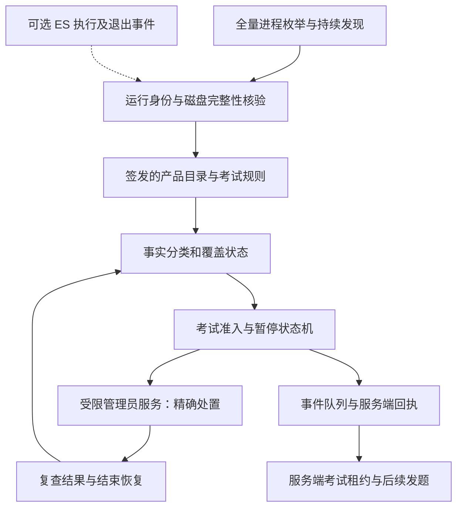
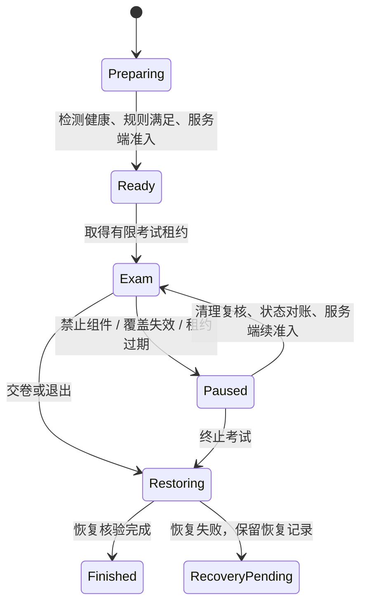

# 远控伪装识别与考试管控详细方案

日期：2026-11-03。适用范围：本项目 macOS 考试客户端；当前证据来自 Apple M4、macOS 26.6.2、SDK 26.5。其他系统、架构和应用版本须单独验收。

**首版采用“管理员授权与服务就绪 → 全量进程身份检查 → 考前清理 → 考中发现后终止并复查 → 上报 → 结束恢复”的方案，模式为 `reactiveTerminate`。具备相应进程操作权限即可发送终止信号，不需要 ES 专用 entitlement。首版可以独立交付，不等待 Apple 的 ES 授权。**

Endpoint Security（ES）作为后续可选增强；只有产品明确要求对新的执行请求作执行前拒绝，才另行启用 `execDeny` 并验收其授权、部署与健康条件。Hook 保留作特定采集进程的研究和补充验证，不作为发现或终止远控的前提。

本文是待实施设计，不是新增能力的测试报告。本轮只审计代码、核对 Apple 官方资料及本机 SDK、编写方案；没有停止远控、修改签名、安装守护服务或部署 ES。当前实现和实际证据见[运行检测测试报告](远控软件运行检测测试_20261103.md)，既有 Hook 边界见[完整审计](Hook路线完整审计与架构决策_20261102.md)。

## 0. 首版交付范围与两种模式

| 模式 | 执行顺序 | 权限与部署 | 交付定位 |
|---|---|---|---|
| `reactiveTerminate` | 目标已经运行 → 发现并核验 → 暂停考试 → 终止 → 复查 | 对受检第三方组件具备相应操作权限；跨用户/root 组件由经批准、身份验证且实际就绪的管理员服务处理 | 当前首版，包含考前清理、考中处理、上报与结束恢复 |
| `execDeny` | 系统准备执行目标程序 → ES 授权判断 → 拒绝该次执行；已有组件另行清理 | 额外要求 Apple ES entitlement、对应运行权限及部署批准 | 后续可选增强，不是首版或 `kill` 的前置条件 |

首版验收用语是“发现运行后已终止”“本轮清理核验通过”；不能写成“从未启动”“执行前拦截”或“零运行窗口”。`kill` 的返回值与后续观察结果分别记录，不能用信号提交成功替代退出验证。

考试策略显式记录模式和所需能力。首版不因没有 ES entitlement 而拒绝开考，但仍必须满足管理员服务、身份检查、监测健康和上报规则。未启用 ES 时状态为“不适用”；若某场考试明确要求 `execDeny`，ES 不可用时不得静默降级成首版后继续称为执行前拒绝。

## 1. 目标、威胁与判断边界

首先解决“是否有考试禁止的软件组件运行”，再解决“发现后如何暂停、处置、恢复”。这一规则不必等待对方真正连接或取得试题才生效。

必须分开记录四件事：**组件在运行、会话已连接、发生远程输入、构成作弊**。前一项成立不能自动证明后一项。自动处理可以依据明确的考试环境规则；作弊认定保留人工复核。

| 对方行为 | 可依靠的证据 | 预期结果与边界 |
|---|---|---|
| 改进程显示名、外层 App 名或搬移目录，原签名仍有效 | 经验证的 Team ID、Signing ID、组件指纹 | 仍能识别目录中的产品；名称和路径不作为发现前提 |
| 使用相同名称、图标或版本号假冒远控 | 证书要求、签名验证结果 | 不把它误认成原厂软件；未知代码按考试策略处理 |
| 修改文件、去签名或重新签名 | 动态身份与静态完整性分别检查 | 原厂身份可能失效；标记异常或未知，不能仅凭残留字符串断定就是 UU |
| 正版软件升级 | Team/Signing ID、版本、架构、CDHash、策略版本 | 仍可识别稳定组件身份；指纹变化须按更新策略处理，不直接判作弊 |
| 借合法浏览器、解释器或插件宿主远控 | 宿主身份、允许的功能和内容、补充行为线索 | 主程序签名正常不能排除；仅三产品黑名单不足以覆盖 |
| 自编、未知品牌远控 | 应用允许列表、受控考试环境 | 没有通用的“远控特征值”保证识别全部未知实现 |
| 停掉检测服务、撤销权限、阻断上报 | 本地健康状态、服务端心跳与回执缺口 | 记录检测覆盖中断，暂停考试；不凭失联判定具体攻击方式 |
| 对方控制系统安全配置或系统本身已不可信 | 管理环境与系统保护前提、外部接收记录 | 本机日志不再足以证明完整事实；不能承诺所有绕过均被记录 |

普通管理员权限与控制内核不是同一件事。在系统保护有效时，管理员不能随意伪造 Apple 或其他厂商的有效签名；但设备所有者能否停用组件、改变启动安全状态、破坏测量链，需要按部署环境分别评估。ES 系统扩展的保护也不能推广为任意设备状态下不可绕过。[Apple 的系统扩展保护说明](https://developer.apple.com/videos/play/wwdc2020/10159/)

## 2. 当前实现与必须修复的漏点

当前只读工具已连续三轮观察到 ToDesk、UU、向日葵的已验证组件，共 11 个候选、9 个通过磁盘签名要求；另外 2 个分别为权限不足、资源封印校验失败。每轮约 4.1–4.3 秒，并有 52 个 PID 的路径无法读取。18 项逻辑测试通过，另有同名合成程序负例。以上不等于全量反伪装检测、运行内存证明、考试门禁或强退已经实现。

需要一起修改下列四处，不能只删掉一次名字过滤：

| 当前代码 | 问题 | 设计变更 |
|---|---|---|
| [原生枚举器](../Hook新方案_20261101/Sources/RemoteProcessInventory/main.swift)的 `enumerate()` | 无名称/路径线索即跳过，路径读取失败也不继续核验代码身份 | 枚举全部 PID，尝试查询运行代码身份；路径可空，失败保留明确原因 |
| [检测脚本](../Hook新方案_20261101/scripts/detect-remote-processes.py)的 `match_policy()` | 要求厂商也出现在 `hints` 中 | 依据验证后的代码身份匹配；名称只参与检查优先级和解释 |
| 同脚本 `summarize()` 的厂商统计 | 先按 `candidateVendors` 过滤，再统计已确认身份 | 直接依据 `verifiedVendor` 汇总确认项，避免改名程序在汇总时再次消失 |
| 同脚本 `elif rows or not complete` | 改成全量枚举后，任何普通进程都会触发复核 | 分开“已知远控、非目录软件、未知身份、检查失败”，由考试模式决定处置 |

当前向日葵 Helper 的签名 ID 是字面量 `$(PRODUCT_BUNDLE_IDENTIFIER)`，不是可靠的产品唯一名称。后续应叠加已登记的架构/CDHash 或经验证的包组件归属；证据不足时记为“该厂商未分类组件”，不得因通用 helper 名称自动终止。此设计收紧后续策略，不抹去历史测试的原始结果。

## 3. 架构与职责



检测模块只输出事实和不确定性；策略模块决定考试是否继续；管理员服务只接受受限、可核验的操作；服务端保存已接收证据和自己的时间线。GUI 不能通过一个任意 PID、路径或 shell 字符串就获得 root 执行能力。

建议新增 `Sources/RemoteGuardCore`，拆分 `ProcessEnumerator`、`CodeIdentityInspector`、`ComponentPolicy`、`IdentityCache`、`DetectionEngine`、`ExamPolicyEvaluator`。Python 脚本保留作诊断和报告入口，高频生产检查迁到原生模块，避免逐进程反复启动多个 `codesign` 子进程。

核心接口建议为：

```text
enumerate(scope, deadline) -> InventorySnapshot
inspect(processIdentity, policy, deadline) -> CodeEvidence
classify(codeEvidence, catalogue) -> ComponentAssessment
evaluate(snapshot, examPolicy, monitorHealth) -> ExamDecision
enforce(decisionID, executionIdentity, examEpoch) -> ActionReceipt
```

接口名称与下列字段是设计草案，尚未实现。

## 4. 首版基础：不依赖 ES 的身份发现

### 4.1 运行中的程序与磁盘文件分别核验

1. 先枚举全部可见 PID，记录枚举时刻、UID、出生时间和实际路径（如可读）。名称仅作线索，不影响是否尝试身份核验。
2. 通过 `SecCodeCopyGuestWithAttributes` 取得运行代码对象。普通查询使用 PID；只有取得可信来源的 audit token 时才使用它绑定实例，不从 PID 拼造 token。路径不可读的 PID 仍尝试此查询。
3. 读取 Team ID、Signing ID、CDHash 等元数据用于检索目录。元数据读取成功不代表签名验证成功。
4. 对匹配的产品组件，用 `SecCodeCheckValidityWithErrors` 核验运行代码对象及要求：Apple 签名锚、预期 Team ID、精确 Signing ID，必要时叠加已登记指纹。
5. 对磁盘代码独立做静态校验，记录检查对象是执行文件还是整个包、选用的标志、资源封印结果和文件变化。不得把单个执行文件验证称为所有嵌套组件均通过。
6. 再次观察进程与文件；退出、变化或核验超时都保留不确定性。不能沿用检查开始时的 PID 结论实施之后的操作。

动态核验验证的是身份成立所需的代码签名组件及宿主报告的有效状态，不是完整扫描所有运行内存。静态包资源损坏与运行身份无法取得也不是同一个结论。[Apple 运行代码查询](https://developer.apple.com/documentation/security/seccodecopyguestwithattributes(_:_:_:_:))、[动态代码验证](https://developer.apple.com/documentation/security/seccodecheckvalidity(_:_:_:))；细节已核对本机 SDK 的 `Security.framework/Headers/SecCode.h`。

### 4.2 身份目录与考试规则分开

| 数据 | 用途 | 不能单独证明的事 |
|---|---|---|
| Team ID 与有效证书要求 | 确认签名发行者 | 同厂商所有产品都是远控 |
| 精确 Signing ID | 识别组件 | 字符串本身是真实签名；泛化 ID 唯一 |
| CDHash、架构和版本 | 关联已知构建，处理泛化 ID 与更新 | 所有已加载代码及内存均可信 |
| UID、执行实例、父子关系 | 区分用户、生命周期和服务关系 | 一定是考生主动启动 |
| 路径、名字、图标、网络端点 | 辅助解释与核验优先级 | 可靠厂商身份或作弊事实 |

目录逐组件记录 `product/role/identityRequirement/knownBuilds/policyVersion`，角色至少区分 GUI、采集服务、会话代理、守护服务、共享 helper、更新器。处置规则另行声明哪些角色禁止运行、哪些需要复核；更新器存在不能描述成活动远控会话。

策略应由服务端签发，包含版本、有效期、适用平台、最小客户端版本和策略代次。客户端验证签名，服务端也检查考试使用的版本。纯本地可写 JSON 的哈希只能追溯输入，不能抵抗管理员替换整个检测器与策略。升级新增组件先收集验证证据，不按名称自动扩充可信目录。

### 4.3 输出多维状态，避免把“未知”写成“安全”

```text
process: bootSessionID, pid, uid, birthTime, executablePath?
         pidversion? , identityStrength
observation: source, observedAtUTC, monotonicTime, duration
code: reportedTeamID, reportedSigningID, cdhash, architecture
      metadataStatus, dynamicValidationStatus, staticValidationStatus
      requirementDigest, policyVersion, OSStatus, failureReason
assessment: verifiedVendor?, verifiedComponent?, verifiedRole?, category
coverage: pidEnumerationComplete, runtimeIdentityCoverage
          staticValidationCoverage, temporalCoverage, unresolvedReasons
decision: allowStart / blockStart / pauseExam / needsReview
```

建议事实分类为：已验证的已知远控、元数据相似但校验失败、已签名的未分类代码、未签名/临时签名代码、身份检查不可用、检查过程中退出或变化。另设行为证据字段，不把这些分类自动转换成“正在作弊”。

52 个不可读路径应逐项分析：尝试运行身份查询，区分退出竞争、权限不足和系统特殊对象；有可信身份依据的系统对象才可按明确规则排除。不能根据名字、数量或“看起来都是系统进程”统一放行。仍不能解释且影响严格检查范围的项目，输出环境不满足准入，不偷偷改成检测完整。完整性是带范围与时间的声明，不承诺原子系统快照。

### 4.4 性能、缓存与短时进程

首次做完整发现，考中做增量检查加周期性对账。缓存分别记录执行身份、磁盘校验、策略决定，不能只以 PID 或路径为键。文件/架构/指纹、策略版本、运行实例变化均使对应缓存失效；未知项和正结果也需有界刷新。

整个包的静态完整性缓存不能仅凭主执行文件的 `stat` 不变继续复用；资源和嵌套组件变化也应纳入失效或周期重验范围。

现有 `PID + UID + path + birthTime` 不能可靠区分“同 PID、同路径重新 exec”。没有可信执行版本来源时必须声明这一弱点，设置复查和过期，不能伪造 `pidversion`。文件 `stat` 可用于减少重复工作，不能单独作为对抗管理员篡改的证明。

为扫描和工作队列设置整体预算、有限并发及积压上限；超预算时记录缺口并交给准入策略。同步 Security API 不能靠取消一个 Swift Task 保证中止；耗时检查隔离到可管理工作进程，过期结果不得覆盖新状态。界面不能等扫描结束才响应暂停。

性能先测再定承诺。建议第一轮以 500 ms 的发现调度间隔进行实验，身份复核异步进行；记录从进程实际出现到发现、到身份确认、到隐藏试题、到退出核验的各段延迟与漏检。调度间隔不是检测保证，短于轮询空窗的程序仍可能漏掉。当前约 4 秒的全流程不能直接承担此调度。

## 5. 两种考试策略，处理重签和未知程序

| 模式 | 已确认禁止远控 | 未分类、重签或无法核验程序 | 覆盖范围 |
|---|---|---|---|
| 兼容模式：已知禁止目录 | 阻止开考；考中暂停并处置 | 展示风险/复核；按明确规则处理检查缺口 | 适合先验证已知软件；不能宣称阻止全部未知远控 |
| 严格模式：允许列表与受控功能 | 同左 | 未满足允许规则的考试相关执行环境不准入或暂停 | 可收紧未知代码，但需系统兼容、辅助功能和业务应用适配 |

“没有匹配三家远控”不等于“允许”。严格模式的允许列表不仅是应用名称或厂商列表，还应包含允许的组件、版本范围和功能约束。浏览器网页、扩展、脚本、解释器、插件及已有宿主中的代码，可能在不新启动远控主程序的情况下工作；允许整个浏览器或整个 Apple 厂商并不能解决这个问题。

建议先交付兼容模式的准确检测和完整异常链，再在受控测试机验证严格模式。若目标是高强度考试，应并行评估 Apple 的 Automatic Assessment Configuration（AAC）和受管理设备部署；AAC 的授权、应用兼容性、辅助功能与业务流程另设验收，不承诺本项目现已具备。[Apple 考试模式说明](https://support.apple.com/en-us/101976)

## 6. 首版核心：考试状态机、管理员处置与恢复

### 6.1 考前、考中和结束的顺序



准备页不含真实题目。先启动监测，再扫描现存进程，确认必要权限和策略；发现禁止组件则暂不允许开考。清理完成、持续观察符合规则、服务端准入后才加载试题。

考中出现禁止组件或检测覆盖失效，**先撤下试题并暂停考试，再执行退出、核验和上报**。上报异步进行，不让网络等待延迟暂停。单次后续扫描干净不自动恢复考试，须检查处置结果、监测健康、异常策略及服务端状态。

目前 [NativeExamDemo](../Hook新方案_20261101/Sources/NativeExamDemo/main.swift)先展示试题，周期检查主要更新标签，退出主要保存状态。实现时应改成独立的 `ExamSessionCoordinator`，接管题目加载、暂停视图、续考与结束；不能只加一个红色告警标签。隐藏本机试题不能撤回已经传到远端或被保存的画面。

### 6.2 管理员服务只做有界、精确操作

管理员权限通常可处理相应第三方进程，但不赋予任意系统进程控制权，也不替代 ES 的 entitlement。macOS 13+ 可评估以 `SMAppService` 管理自家签名、按要求公证的后台服务；注册状态、用户批准和实际运行健康要分别检查。[Apple SMAppService](https://developer.apple.com/documentation/servicemanagement/smappservice)

授权和就绪分开验收：客户端发起自家管理员服务的正规安装/注册流程，检查系统批准状态，再通过受认证连接核对服务签名、版本、实际权限和健康响应。点击一次授权弹窗不等于 GUI 永久取得 root，也不等于后台服务已运行。跨权限目标所需服务未安装、待批准、身份不符、权限不足或失联时，显示具体原因，停止开考或暂停考试；不反复索取密码，也不保存管理员密码。

同一用户的进程在系统允许时可能无需提升权限即可终止；首版仍用统一受限接口管理处置。是否需要管理员权限取决于目标和系统检查结果，不能根据其他客户端能退出微信推断本 Demo 已具备 root 服务。

管理员服务的 XPC 接口必须验证真实发送方的代码身份；采用消息/连接携带的可信身份，不能信任请求正文自报 PID。操作请求至少绑定考试会话、策略代次、有限租约、已核验目标身份及唯一操作 ID。服务端下发策略也不能转化成任意 shell 执行器。

处置流程：重新读取目标身份 → 核对禁止规则和所属用户范围 → 对已登记且需要处理的自启动任务暂时停止 → 请求正常退出或发送 `SIGTERM` → 在策略规定的有限宽限后，对仍匹配的具体实例必要时发送 `SIGKILL` → 核验退出及是否出现新实例。每次信号操作前重查身份、考试代次和租约；宽限与重试预算需实测配置，不无限等待或重复杀进程。`SIGKILL` 也不能代替退出核验或防止其他服务重新拉起。

| 操作或观察结果 | 记录与后续动作 |
|---|---|
| `kill` 返回 0 | 只记信号已提交；继续核验目标是否消失 |
| 返回 `EPERM` 等权限拒绝 | 记处置失败及错误码，保持暂停；不当作清理完成 |
| 返回 `ESRCH` | 重新观察目标实例；确认已消失可记本次观察到不存在，但不能声称由本次信号杀死 |
| 原实例消失，但对应禁止组件出现新实例 | 分别记退出结果与重新出现，继续暂停；按有界预算处理新实例 |
| 身份改变、读取失败或核验超时 | 终止该次针对旧身份的操作，记未确认，重新识别；不升级成按名字批量终止 |

复查结果区分 `signalSubmitted`、`terminationVerified` 和 `cleanupVerified`：前者是一次系统调用结果，中间是原实例已消失，最后才是本轮所需组件、任务与检测健康均满足清理规则。任何一项均不证明此前没有传出画面。

不得使用宽泛 `pkill`、按显示名批量杀进程或信任 GUI 任意传入的路径。对于身份未知、泛化 helper 或共享系统宿主，不自动扩大强退范围；暂停考试并提示处理。存在其他登录用户时，系统级共享远控服务可能影响其他会话，应列为部署约束，不能静默扩大用户范围。

`kill(pid)` 与之前的身份核验仍存在检查/使用间竞争，出生时间复查只能降低风险，不能宣称原子绑定；没有足够身份依据时跳过处置、保持暂停并记录未知。高权限用户主动停用普通 helper 后，不能保证其继续工作。

UU 等后台服务可能由 `launchd` 自动拉起。一次 kill 不能阻止再次运行；重新出现可能是自动保活，不能直接写成“考生故意绕过”。每个已支持产品单独登记任务、所有者、组件关系和恢复方式，不改厂商二进制、不永久关闭服务、不更改 SIP 或签名策略。细化事务可复用[既有进程管控设计](UU考试进程管控设计_20261102.md)的要求，不能直接把旧实验脚本当生产 helper。

### 6.3 结束自动恢复必须独立验收

每次变更前保存恢复记录，记录任务定义摘要、原注册/启用状态、用户域及本次改动。正常结束先撤下试题，失效考试代次，停止接收新处置，有界等待已发操作完成，再撤销执行限制，恢复仅由本次改变的状态。恢复与处置共用串行控制点，避免迟到的 kill 伤及已恢复进程。

租约用包含休眠的连续单调时钟计时，并绑定启动会话；修改系统时间不能延长它。GUI 崩溃、租约到期、服务重启进入中断与恢复流程，不得自动重新延长旧租约。系统重启后不继续套用旧考试授权。有限租约限制正常组件失联时的影响，不能保证整台主机失控或所有服务都被杀死时仍按时恢复。

恢复不重放旧远控连接、密码或控制请求。原本关闭的 GUI 不自动打开；原先运行且本次关闭的组件按恢复策略处理。任务被外部更新时不得用旧备份覆盖新版本，转为恢复待处理。分别确认“考试限制解除”“任务/进程状态恢复”“远端重新连接且画面操作正常”。

## 7. 可选增强：ES 提供更强执行身份与启动授权

本节只适用于另行选择的 ES 增强工作，不属于 `reactiveTerminate` 首版的交付前置条件。首版先完成检测、管理员终止、复查、上报与恢复；需要执行前拒绝时再启用本节方案。

ES 在用户态消费系统提供的事件，可获得执行实例、签名身份及执行操作的授权机会，不需要自己开发传统内核驱动。它不是所有系统调用的汇总器，也没有“某进程正在远控/截屏”的通用字段。

部署需要 Apple 的 `com.apple.developer.endpoint-security.client` 专用授权，并满足 root、完整磁盘访问等运行条件；系统扩展还涉及对应安装能力及用户或 MDM 批准。管理员密码不能替代这些条件。[Apple ES entitlement](https://developer.apple.com/documentation/bundleresources/entitlements/com.apple.developer.endpoint-security.client)；运行失败类型已核对本机 SDK `EndpointSecurity/ESTypes.h`。

### 7.1 事件、执行实例和初始存量

先建立并验证事件订阅，然后枚举已经运行的进程；有界缓冲扫描期间的事件，合并后再次对账。缓冲溢出、序号缺口或未解释的实例变化均不得宣布准入完整。仅订阅 `AUTH_EXEC` 不会关闭已存在的远控会话。

事件以 EXEC/FORK/EXIT 为基础，按本机 SDK 和系统实际支持能力配置；附加完整性事件只作线索。ES 的 `audit_token` 可提取 `pid` 和 `pidversion`，与设备/启动会话组合关联一次执行；`exec` 可能保持 PID 和出生时间，却改变执行版本。缓存和处置记录不能继续只用 PID。

`AUTH_EXEC` 判断新程序应读取 `event.exec.target`，不能把 `message.process` 中的 shell、launchd 或旧执行身份当成目标程序。签名字段反映事件时刻状态；`CS_VALID` 仅说明截至当时已检查部分有效，不能证明全部代码页、动态库或内存均已验证。[Apple es_process_t](https://developer.apple.com/documentation/endpointsecurity/es_process_t)；已核对本机 SDK `ESMessageCore.h` 的执行版本、按需页面验证说明及 `ESTypes.h` 的 CDHash 条件。

### 7.2 授权回调与失效行为

授权回调只用内存中的有效策略、考试代次和事件身份作有界判断，不同步调用 `codesign`、扫描整个包、等待服务器或大量写盘。需要慢核验的项采用预先定义的策略结果，并让考试进入相应暂停/复核状态；不能一直挂起系统调用。按每条消息的 deadline 提前响应，检查返回值，避免重复回复，正确管理异步消息生命周期。

ES 增强的初次实现建议授权回复 `cache=false`，先保证开始、结束和租约变更正确；以后再专项优化缓存。不能把频繁清理共享授权缓存当策略正确性的替代。系统默认静默、主动静默、授权缓存与未订阅范围都要写入覆盖声明，不盲目解除关键系统默认静默，也不整体拒绝所有不认识的系统执行。

超时可能导致该次执行隐式放行并终止 ES 客户端；因此 ES 失效时应暂停考试，服务端停止后续发题，不能保持“受保护”绿灯。[Apple AUTH deadline 和超时行为](https://developer.apple.com/videos/play/wwdc2020/10159/)

按 `message.version` 使用支持的 `seq_num/global_seq_num` 字段，跟踪客户端重连代次、积压、写盘和上报错误。序号缺口说明应检查事件丢失；没有缺口不能证明静默、缓存或未订阅事件均已覆盖。健康心跳独立于业务事件，不能因为暂时没有 EXEC 就判断服务停了。[Apple global_seq_num](https://developer.apple.com/documentation/endpointsecurity/es_message_t/global_seq_num)

ES deadline 的时基与考试租约所用的连续单调时钟不同，不能直接混算。执行拒绝分别记录“决定拒绝”“系统接受响应”“受控测试中目标未执行”；日志写出一条 deny 不等于完成了实际阻断验证。

## 8. 自身防篡改与辅助行为证据

正式客户端及 helper 应采用受控发布签名、Hardened Runtime，移除仅开发需要的调试/放宽库校验授权；按真实依赖验证兼容性。自身关键模块、策略加载和运行环境可做完整性检查，但不能把首次观察值直接当作干净基线；可信期望来自经过验证的发布产物和策略。

客户端自检是补充：同一进程被控制后，自检结果也可能被伪造。ES 的签名失效、调试相关事件或异常父子执行链可增加证据，但不是所有 Hook 的统一检测器。目标主程序签名正常，也不能排除合法扩展能力、插件或运行时滥用。

网络连接、屏幕采集框架、输入合成 API、虚拟显示等可按后续专门授权和工具能力作辅助线索。视频会议、辅助功能、自动化与远控可能共享这些特征；权限获授不证明当前使用，流量或鼠标变化也不能单独证明远端操作者。首版不采集键盘内容、试题画面、全部网络载荷或第三方命令行作为“通用特征库”。

## 9. 服务端留证与异常标记

首版事件建议分为：`forbiddenComponentObserved`、`identityValidationFailed`、`inspectionUnavailable`、`terminationAttempted`、`terminationVerified`、`monitorCoverageLost`、`examPaused`、`restoreCompleted`、`restoreFailed`。启用 ES 执行拒绝后才增加 `execDenied`，不能用它表示首版的 kill 结果。保留观察事实、处置结果和推断来源，不能合并成一个 `cheating=true`。

每条事件携带考试会话 ID、设备注册标识、启动与监测代次、递增序号、事件 ID、执行身份、签名证据摘要、规则版本、错误码、客户端时间和单调时间。服务器另记接收时间与幂等回执。本地有界队列负责重传，断网、队列溢出、磁盘满、日志链断裂均可见；不以无限缓存保证可靠性。

服务端维护独立的考试租约与最后健康时间。缺少有效健康续约后停止后续题目授权；客户端按本地到期时间暂停。不能在考试开始就把整套明文试题和长期有效密钥交给客户端，然后指望停止发题能收回全部内容。续约频率、断网宽限和恢复规则由考试产品策略明确并压测。

哈希链、设备签名、TLS 和服务端接收记录可帮助验证记录关联、传输与事后修改，但**不能把已受控制客户端编造的测量变成真实事实**。服务器可以证明自己收到过某条记录、某段时间没有收到续约；不能仅凭空档证明发生了远控。建议后台展示“违反运行规则”“身份异常”“检测失效”“待复核”，并附证据时间线。

## 10. 分阶段交付与验收

| 阶段 | 具体工作与产物 | 本阶段验收条件 |
|---|---|---|
| P1：全量身份发现 | 修改四处过滤/汇总；原生动态身份；多维失败状态；策略角色收紧；新 CLI 报告 | 改名无 hints 的端到端用例通过；普通软件不被误认；未知原因可解释；实测性能和漏检窗口 |
| P2：考试准入与暂停 | `ExamSessionCoordinator`、准备页、题目延迟加载、健康覆盖状态、模拟服务端契约 | 初始不显示试题；发现禁止组件或覆盖失效即暂停；没有合格结果不能变绿 |
| P3：处置、恢复与上报 | 受限 helper、逐厂商任务适配、恢复日志、有限租约、真实服务端回执 | 约定故障场景内有界恢复；恢复失败可诊断且有人工恢复入口；上报准确区分事实与缺口 |
| P4：可选 ES 增强 | 仅在需要执行事件/执行前拒绝时另行实施；Apple 授权与部署；先 NOTIFY，再 AUTH | 初始扫描合并、执行身份、丢事件/超时、策略切换和结束恢复均通过 |
| P5：可选严格考试环境 | 另行评估允许列表、脚本/插件/浏览器约束及 AAC/受管理部署 | 业务和辅助功能兼容；对未知代码、系统不可信和离线场景有明确产品决定 |

**P1–P3 共同组成可独立交付的首版，均不依赖 ES 授权。** P1/P2 可先作阶段演示；完成 P3 的真实处置、服务器回执和恢复验收后，才可称为完整的首版管控。不能用写入本地 JSON 冒充上报。

P4、P5 是按产品要求另选的扩展，不是首版必须等待的阶段，也不要求彼此前后依赖。选择 ES 后再推进 Apple 授权与部署，其审批时间和是否获批不作保证；不能把尚未实现的执行前拒绝写进首版能力。

## 11. 必测矩阵

下表为新增验收计划，不是已通过测试。先使用不联网、不采集屏幕的自有测试程序验证身份、exec 与生命周期；真实远控的运行/处置/恢复按独立场次测试。不重签正式安装的远控，不用测试策略放宽生产证书要求。

若 macOS 在执行前拒绝损坏或无有效签名的测试样本，应记录为系统拒绝启动；不得要求样本必须成功运行，也不得将系统拒绝启动归为检测器失败。

### 11.1 首版 `reactiveTerminate` 必测

| 场景 | 合格判据 |
|---|---|
| 没有 ES entitlement，管理员服务及本模式其余条件合格 | 可按首版进行准入、处置与恢复测试；ES 状态为“不适用” |
| 用户取消授权、服务待批准、注册成功但不可运行 | 明确权限/服务未就绪；不能标为已经具备处置能力 |
| 自有签名程序随机改名并搬移，名称线索为空 | 仍经身份目录匹配并进入最终汇总；证书不足时使用隔离测试策略并明确非真实厂商验证 |
| 原厂完整 App 副本仅改外层名称，静态检查 | 身份保持时仍匹配；不启动副本的结果只标为静态验证 |
| 同名假程序、同 Team 其他产品、相同泛化 ID 不同指纹 | 不误确认原厂远控或已登记 helper；不错误终止 |
| 自有程序修改/去签/重签、合法版本更新 | 分别显示失效、未知身份、更新变化；不能自动都判作弊 |
| 路径不可读但运行身份可读 | 继续核验，不因路径为空丢弃 |
| 权限不足、API 错误、核验超时、扫描容量不足 | 显式不完整；本模式必需检查不满足时不准入或暂停，不输出“无远控” |
| PID 重用、同 PID exec、检查中退出或文件替换 | 不复用旧结论；没有强执行身份时如实记录限制 |
| 普通无关进程混入全量表 | 不因 rows 非空就误报远控；允许与否另走考试规则 |
| 扫描期间启动/退出、短生命周期及高负载 | 报告发现率、漏窗、延迟分位数、最大值和系统开销 |
| 原版三家：GUI 退出但服务存活、考试前已连接 | 后台组件仍可检测；开考前真实会话及相关禁止组件已处理 |
| 同用户 GUI 可终止，但 root 后台组件无权限清理 | 不以 GUI 退出替代整体完成；保持准备或暂停状态 |
| 信号返回成功但实例仍在；正常退出被忽略；核验中身份改变 | 按有限预算复查，必要时对重新核验的目标强退；不以调用成功冒充退出，不沿用旧身份 |
| 考中人工重启、launchd 自动保活重启 | 暂停与处置生效；记录来源证据，不武断归因人为作弊 |
| helper 被停、权限被撤、断网、磁盘满 | 本地或服务端发现可观测缺口，按租约暂停；不保证得知具体攻击原因 |
| 交卷、GUI 崩溃、helper 重启、睡眠、改系统时间、系统重启 | 不无限延长旧限制；恢复只处理本轮变更，失败可诊断 |
| 恢复与迟到处置并发、外部软件更新任务 | 不再杀已恢复进程；不覆盖外部新状态 |
| 最终远端恢复 | 完全重连后确认画面、动态计数和操作正常；进程重新出现不能替代此项 |

### 11.2 仅选择对应增强模式时追加

| 场景 | 合格判据 |
|---|---|
| 已要求 `execDeny`，但 ES 未授权/未批准/FDA 缺失或连接失败 | 不满足增强模式准入；不得静默降级并宣称执行前拒绝。这不是首版缺少 ES 时的处理规则 |
| ES 已启用后超时、丢消息或队列溢出 | 具体原因可见，覆盖失效暂停；不谎称仍在拒绝启动 |
| ES AUTH 允许/拒绝、缓存与策略代次切换 | 独立观测目标是否执行，检查响应返回值；结束后无残留拒绝 |
| 严格模式允许浏览器、脚本或插件宿主 | 明确已覆盖功能与仍可利用的路径，不以主程序签名通过代替功能约束 |

报告统一列出运行版本、权限、策略摘要、证据来源、覆盖缺口、各段延迟和恢复结果。有限样本全部通过只能证明这些场景，不写成所有未知远控、所有管理员行为均无法绕过。

## 12. 本项目的实施建议

**按 P1 身份检测 → P2 考试门禁 → P3 管理员处置、上报与恢复实施，作为一版完整功能交付；ES 暂不作为本轮实施依赖。** 先用自有改名/exec 程序补上反伪装证据，再用模拟执行器验证处置与恢复状态机，最后在专门测试场次验证三家真实远控的清理、重新启动、暂停、终止及恢复。该顺序避免将未验证的目标身份直接用于强退，同时不阻塞在 Apple ES 申请上。

本方案的主要保障是：已知禁止组件能够被准确发现；身份或监测可信度不足时不会继续宣称环境合格；处置失败和恢复失败可见；已经送达服务器的记录可被保留。对未知远控与最高权限对抗，需要更严格的允许策略、系统保护和部署条件共同支撑，无法靠增加 Hook 数量或收集一个内核特征值代替。
