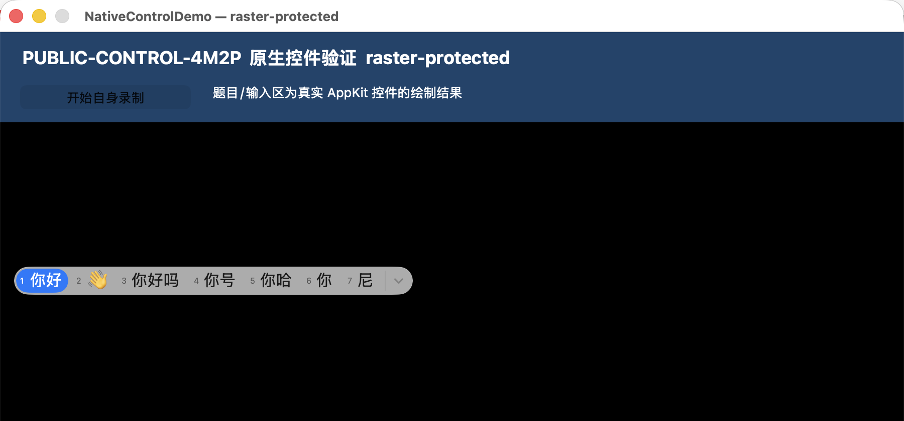

# 中文输入法验证结果

审阅日期：2026-11-01。证据批次：[native-ime-20261101T134127Z](../artifacts/native-ime-20261101T134127Z)。本文件依据已保存的输入事件、Demo 状态、捕获报告及原始截图做独立复核，没有重新启动 GUI，也没有把截图当作本机人眼观察。

**结论：本轮原生输入框通过了系统简体拼音输入法的组合与提交自动用例；“完整中文输入过程不被外部捕获”的目标未通过。** 在 `raster-protected` 模式，受保护题目/输入画布呈黑色，但整屏截图和矩形截图清楚包含“你好”等候选文字。候选界面没有被包含在受保护视频画布中。仅抓主窗口得到黑画布，无法发现这个反例。

## 1. 本轮确实经过了系统中文输入法

测试脚本 [run-native-ime.py](../scripts/run-native-ime.py) 依次运行 `direct`、`raster-baseline`、`raster-protected`。各轮先清空合成输入框，通过已授权的独立输入探针点击聚焦，再确认当前输入源为 `com.apple.inputmethod.SCIM.ITABC`（Pinyin – Simplified）。随后投递 `n`、`i`、`h`、`a`、`o` 的虚拟键按下/抬起事件，保存组合状态；最后投递空格，保存提交状态。

事件记录中的虚拟键码依次是 `45、34、4、0、31`，空格为 `49`。组合阶段共投递 10 个按键事件，提交阶段投递 2 个；不是直接把 Unicode “你好”写入控件，也不是用 `setMarkedText` 人工制造组合状态。输入探针的 `posted_delivery_unverified` 只代表投递；以下编辑器状态和实际图像才补充证明 Demo 收到了输入。

| 模式 | Demo PID | 外部捕获 PID | 组合状态 | 提交状态 |
|---|---:|---:|---|---|
| direct | 14170 | 14239 | `editorText="ni hao"`；`hasMarkedText=true`；范围 `{0,6}` | `currentText="你好"`；`hasMarkedText=false` |
| raster-baseline | 14280 | 14350 | 同上 | 同上 |
| raster-protected | 14393 | 14459 | 同上 | 同上 |

三个模式的 field editor 均已 attached，实际编辑器为 `NSTextView`。两种 raster 模式由可见 `ProxyView` 接收输入，离屏源窗口的第一响应者为 `NSTextView`。保护模式组合和提交时源窗口均为 `sourceWindowVisible=false`、`sourceWindowEverOrderedFront=false`，位于 `(-10000,-10000)`，本轮没有主动展示源窗口。

人工复核保存图像可见：`raster-baseline/capture-composition/sck-screenshot-window.png` 的输入框显示带下划线的 `ni hao`；`raster-protected/03-commit-source.png` 的真实原生控件绘制结果显示 `你好`。后者是应用内部的源位图，证明绘制输出含提交后的中文；它不是外部截图，也不证明物理屏幕上的显示效果。

本轮系统为 macOS `26.6.2 (25G83)`。三个捕获探针均记录 `permissionBefore=true`、`permissionAfter=true`；输入探针均记录已有 AX/事件投递授权，没有申请新权限。初始输入源本来就是上述简体拼音；`finally` 中恢复同一原输入源，返回 `OSStatus=0` 且当前 ID 匹配。没有安装或启用新输入法，也没有直接写入输入法偏好设置。对应证据为根目录的 `initial-input-source.json`、`restore-input-source.json` 及各模式 `select-input-source.json`。

## 2. 已确认的候选窗泄露反例

独立审阅直接打开原始 PNG，确认以下结果；没有依赖 OCR 关键词或仅凭保存成功判定。

| 保护模式的组合期捕获路径 | 图像实际观察 | 对完整输入过程的判断 |
|---|---|---|
| SCK 主窗口截图 | 公共蓝色标题正常；题目/输入画布黑色；没有候选条 | 此窗口过滤结果没有覆盖候选窗，不能代表整屏安全 |
| SCK 显示器截图 | 同一黑画布上方可读 `1 你好`、`2 👋`、`3 你好吗` 等候选 | **未通过：外部捕获获得输入相关内容** |
| SCK 矩形截图（主窗口所在屏幕区域） | 黑画布与候选条同时存在，候选词可读 | **未通过：不是仅整屏范围过大造成的现象** |

原始证据分别为保护模式 `capture-composition/` 下的 `sck-screenshot-window.png`、`sck-screenshot-display.png`、`sck-screenshot-rectangle.png`，三份报告状态均为 `saved`。显示器图为 `3024×1964`，窗口图和矩形图为 `1800×1244`；矩形范围是屏幕坐标 `(306,103,900,622)`。矩形路径实际调用 `SCScreenshotManager.captureImage(in:)`，不是主窗口截图的裁剪。

图注：上图是原始SCK矩形截图的上半部裁剪，排除了下方无关桌面与远程工具浮窗。原始文件保留在 [sck-screenshot-display.png](../artifacts/native-ime-20261101T134127Z/raster-protected/capture-composition/sck-screenshot-display.png)，候选条也可在独立生成的 [sck-screenshot-rectangle.png](../artifacts/native-ime-20261101T134127Z/raster-protected/capture-composition/sck-screenshot-rectangle.png) 中核对。报告用裁剪不应被当作另一轮独立实验。

捕获报告在保护模式 Demo PID 下枚举到主窗口 `186229`，以及尺寸 `397×28`、位置 `(320,369)` 的无标题窗口 `186238`；后者的位置和尺寸与候选条相符，支持其为另一个窗口的解释。这是从枚举记录与截图位置所做的对应推断，本轮没有按 `186238` 单独抓取并证明其窗口类型。记录将它的 `ownerPID` 归于 Demo PID，因此不能未经证据宣称它一定属于独立输入法进程。可确认的是：候选条像素出现在外部整屏/矩形捕获中，而主画布已经被隐藏。

候选词 `你好` 与随后提交结果一致，足以构成输入相关内容的泄露反例；不应扩大写成“完整答案均已泄露”，也不应因受保护题目文字仍是黑色而忽略候选泄露。背景中其他合成测试窗口不属于本轮受保护画布，不能用那些窗口的文字判断本轮画布是否泄露。

## 3. 证据等级与未完成覆盖

| 子目标 | 本轮证据等级 |
|---|---|
| 系统简体拼音组合并提交“你好” | 已通过这一个真实输入法、虚拟键自动用例 |
| 同一 raster 链路能绘制组合文字及提交后中文 | 已有基线外部截图和保护模式内部源图支持 |
| 中文输入期间，保护模式主画布在所测 SCK 图像中不显示内容 | 已观察到；适用范围为本次三类静态截图 |
| 中文输入过程的候选文字也受保护 | **已找到反例，当前未实现** |
| 本机物理屏幕显示、候选位置与真人连续中文操作 | **未验证**；记录为 `physicalHumanObservation=false`、`IMEPhysicalTestVerified=false` |
| 系统输入法所有分支、其他输入法、其他系统/设备 | 未验证 |

本轮只覆盖一组拼音词和默认空格提交，没有覆盖候选翻页、数字选择、鼠标选择、组合中退格/移动光标、取消组合、长句、多行输入、焦点切换后的重启组合、双拼/繁体/第三方输入法。静态截图也不能替代连续视频过程、所有远程软件路径或物理观察。输入法源图、Demo 状态及主窗口截图均不能单独证明系统候选窗被保护。

## 4. 对实现路线的影响

这项结果支持继续研究“保留原生控件的编辑逻辑，将绘制结果送入受保护图层”的架构，但否定了“原生输入框接通系统 IME 后，整个中文输入界面自然受保护”的假设。候选、菜单和其他独立浮窗需要各自的处理方案及捕获验证。当前不能承诺通用保留所有系统输入法界面并完整防捕获。

下一步若改变候选呈现方式，必须重新做相同 raster 无保护对照、真实组合/提交状态验证、主窗口/显示器/矩形捕获和物理屏幕确认；不能用禁止中文输入、隐藏所有候选或只排除候选窗口的捕获过滤器替代原目标验收。公开接口语义见 [native-api-evidence.md](../research/native-api-evidence.md) 的 `NSTextInputClient` 与 field editor 部分。
